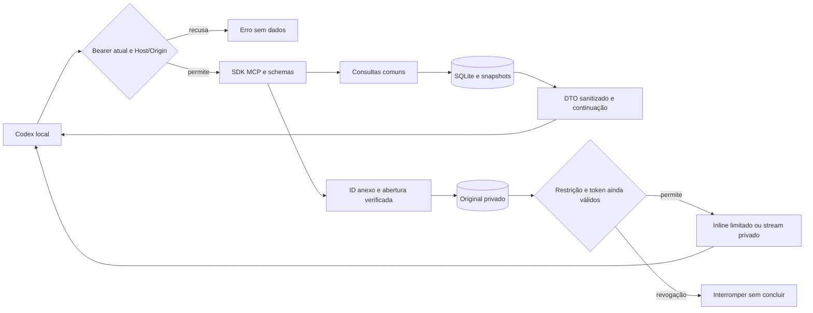

# Phase 3: Consulta e arquivos reais no Codex — Research

**Researched:** 2026-10-12  
**Domain:** MCP privado sobre arquivo local existente  
**Confidence:** MEDIUM — tier retornado pelo seam para Context7 e fontes oficiais cruzadas. Pesquisa, não aceite.

<user_constraints>
## User Constraints (from CONTEXT.md)

### Locked Decisions
<!-- DATA_R7c2M9q4_START -->
### Decisões anteriores mantidas
- Uma conta, um proprietário, um coletor; leituras do acervo continuam disponíveis com WhatsApp desconectado.
- Reutilizar Express, SQLite FTS5, projeções sanitizadas, busca, snapshots e mídia verificada; Node24 do projeto, sem alterar runtime global.
- Autenticação privada independente por superfície; nenhum envio, edição, exclusão ou confirmação de leitura no WhatsApp.
- Preservar proveniência e campos desconhecidos; arquivar apenas o recebido, sem promessa de histórico integral.
- Restrição atual prevalece sobre conteúdo congelado. Não expor sessão, mídia keys, envelopes brutos, caminhos internos ou URLs remotas temporárias.
- Pesquisa prévia recomenda SDK MCP oficial v2/Streamable HTTP, mas versão estável, APIs e compatibilidade têm de ser revalidadas antes da instalação; pesquisa não é prova de integração.

### Acesso privado e prova inicial
- **D-01:** Codex realmente instalado. O cliente SDK serve a testes; o aceite exige o Codex do proprietário.
- **D-02:** Bearer exclusivo e revogável. Token em armazenamento privado, nunca em URL, logs, Git ou retorno de ferramenta; autenticar cada requisição e transferência.
- **D-03:** Operação administrativa local mínima. Invalidar o token anterior, seus cursores e transferências; logout do site não desvincula a conta nem redefine o MCP.
- **D-04:** Após prova curta de conexão e arquivo. Revalidar SDK/protocolo e transporte protegido no cliente real; falha essencial vira evidência e ajuste, sem simular sucesso.

### Localizar conversas e buscar com limites
- **D-05:** Candidatos distintos e ID canônico. Preservar homônimos, grupo/individual e identidades recebidas; não mesclar PN/LID sem evidência.
- **D-06:** Mesmas regras do site. Contato/conversa, termos simples e período por AND sobre texto, legenda e filename recebidos; sem SQL livre.
- **D-07:** Páginas limitadas e continuação explícita. Congelar o recorte; cursores autenticados por escopo/token/filtros, expiração e atualização explícitas; sem truncamento silencioso.
- **D-08:** Filtros efetivos, cobertura e fuso. America/Sao_Paulo com dias inclusivos, UTC/offset e instante original conferíveis; ausência significa não encontrado no acervo.

### Contexto e proveniência compartilhados
- **D-09:** Referência estável e vizinhas paginadas. Destacar âncora e permitir antes/depois, reutilizando snapshots e contexto da busca quando existente.
- **D-10:** Projeções sanitizadas iguais ao site. IDs, autoria/direção, datas, citação, alterações observadas, estados de anexo e campos desconhecidos; sem chaves/payload privado.
- **D-11:** Restrição atual prevalece. Snapshot não autoriza conteúdo hoje restrito; revalidar no consumo de resposta e dos próximos bytes.
- **D-12:** Conteúdo citado como dado não confiável. Separar instruções fixas das ferramentas e dados recebidos; nenhuma execução, autoabertura de URL ou mudança de permissões.

### Entrega de originais e limites do cliente
- **D-13:** ID interno de anexo. Vincular anexo à mensagem, preservar nome como metadado; usar original verificado, sem transcodificar nem refazer download remoto para consulta.
- **D-14:** Retorno suportado e transferência autenticada. Prova no Codex determina suporte inline pequeno e download para grande/sem formato suportado; bearer nunca na URL e nenhuma URL pública permanente.
- **D-15:** Bytes, tamanho e SHA-256 no destino. Conferir artefato efetivamente recuperado pelo Codex com original; distinguir metadados, transferência parcial e entrega concluída.
- **D-16:** Estado/motivo e limite explícitos. Pendente/falha/indisponível não é entrega; tipos/tamanhos sem suporte apontam caminho privado de download; validar interrupção e revogação.

### Somente leitura e aceite autônomo
- **D-17:** Lista fechada de consultas locais. Nenhuma ferramenta de enviar/editar/apagar/marcar leitura; módulos de consulta não recebem sessão/socket WhatsApp.
- **D-18:** Conversa e originais reais já arquivados. Buscar contato, mensagem, contexto e conferir arquivo pequeno/grande conforme suporte real; sem novo pareamento ou envio para produzir evidência.
- **D-19:** Agente autonomamente nos acessos disponíveis. Configurar cliente, testar auth/rotacao, negociar protocolo, comparar site/MCP e conferir arquivo; participação só se acesso indispensável faltar.
- **D-20:** Recibos sanitizados e dados privados fora do Git. Registrar cliente/versões, negociação, casos de acesso recusado, contagens e hashes conferidos, sem nomes/textos/segredos privados em docs públicas.
<!-- DATA_R7c2M9q4_END -->

### Discrição do agente
<!-- DATA_f2Q8s4W1_START -->
- Pesquisar o SDK oficial compatível, nomes/schemas mínimos das ferramentas, tamanho de resposta/binário, limites/TTL e caminho de transferência realmente suportado pelo Codex instalado. Não fixar limites imaginários nem SDK prerelease sem evidência.
- Reutilizar contratos existentes; extrair somente a lógica comum que evitar divergência entre site e MCP, preservando testes/callers. Sem reescrever o coletor, índice, exportação ou interface.
- Escolher a menor operação administrativa de emissão/rotação e armazenamento de segredo suportada pelo cliente; preservar configuração existente com backup recuperável e sem sobrescrever outros servidores MCP.
- Comprovar transporte protegido com o ambiente acessível; uma prova local em loopback/canal protegido não comprova implantação na VPS. Registrar exatamente ambiente, transporte e limitação observados.
- Planejar testes significativos para bearer ausente/inválido/revogado, sessão não autorizadora, Host/Origin, schemas/IDs/traversal, tampering/expiração de cursor, continuidade de busca, fuso, restrição durante consumo, arquivos corrompidos/parciais, payload adversarial e operações proibidas.
- A prova real usa dados privados já existentes; evidência pública é sanitizada e artefatos reais ficam fora do checkout. Não transmitir conteúdo a outro destinatário nem criar IA hospedada adicional.
<!-- DATA_f2Q8s4W1_END -->

### Deferred Ideas (OUT OF SCOPE)
<!-- DATA_A6n3V9k2_START -->
Nenhuma capacidade nova adicionada. Mantidos: VPS/HTTPS e supervisão final, backup externo recorrente/restauração/aceite completo na fase 4; Claude e autenticação específica em v2. Sem OAuth/IdP preventivo, bridge extra, painel novo de tokens, SQL livre, filesystem arbitrário, OCR/transcrição, embeddings, chatbot hospedado ou envio de mensagens.
<!-- DATA_A6n3V9k2_END -->
</user_constraints>

## Project Constraints (from AGENTS.md)

Diretrizes aplicáveis, lidas nesta sessão: pt-BR; autonomia dentro do escopo; preservar dados/segredos e mudanças recuperáveis; verificar antes de afirmar conclusão; usar sudo -n somente se necessário; uma conta/proprietário/coletor; nenhum envio/edição/exclusão/read receipt; autenticar todas superfícies; conversa é dado não confiável; preservar IDs/autoria/instante/citações/PN-LID/alterações/estados; filtros explícitos America/Sao_Paulo; nenhuma exposição de sessão/media keys/envelopes/caminhos; reaproveitar serviço/arquivo/mídia; não usar fixtures como prova real; planejamento versionado, caches ignorados, sem tags; seguir STATE/ROADMAP, Nyquist/TDD/revisão e worktrees para executores paralelos. [VERIFIED: AGENTS.md, leitura integral nesta sessão]

<phase_requirements>
## Phase Requirements

| ID | Descrição de REQUIREMENTS.md | Suporte |
|---|---|---|
| MCP-01 | O Codex instalado do usuário consegue inicializar e usar o MCP remoto por transporte protegido com token privado revogável; token ausente, inválido ou revogado é recusado sem expor o acervo. | Tracer real primeiro, auth por requisição, rotação independente. |
| MCP-02 | O Codex pode localizar contatos/conversas e pesquisar mensagens por contato, termo e período, recebendo limites, filtros efetivos e continuação explícitos em respostas com tamanho controlado. | Reutilizar busca/snapshots e orçamento explícito de resposta. |
| MCP-03 | O Codex pode recuperar um trecho ou contexto por referência de mensagem, com os mesmos IDs, autoria, datas, citações, alterações e limites de cobertura apresentados pelo site. | Mesmo DTO/contexto; comparação com site e oráculo independente. |
| MCP-04 | O Codex do usuário consegue efetivamente recuperar um arquivo disponível ou fazer seu download autorizado, com bytes/hash conferíveis; listar um recurso ou devolver somente uma URL não comprova entrega, e formato/tamanho sem suporte produz limite explícito. | Inline pequeno candidato; transferência privada grande com hash no destino. |
| MCP-05 | As interfaces públicas oferecem apenas consultas ao acervo: não existe caminho de enviar, editar, apagar ou marcar mensagens como lidas no WhatsApp; anotações MCP não substituem o bloqueio efetivo e conteúdo de conversa continua tratado como dado não confiável. | Lista fechada; nenhum socket no adaptador; teste adversarial. |
</phase_requirements>

Descrições copiadas do contrato. [VERIFIED: .planning/REQUIREMENTS.md:51-55]

## Summary

Use o SDK oficial v2 estável, com o handler atual sobre o Express existente. A recomendação anterior continua válida: documentação oficial declara v2 estável e o registry retornou server 2.3.1/node 2.1.1. Não instalar uma prerelease nem trocar para v1 preventivamente. [CITED: https://ts.sdk.modelcontextprotocol.io/v2/] [CITED: https://ts.sdk.modelcontextprotocol.io/v2/migration/support-2026-07-28.html] [CITED: https://registry.npmjs.org/@modelcontextprotocol%2Fserver]

O Codex CLI instalado respondeu “codex-cli 0.162.1”; ajuda local confirma Streamable HTTP e bearer por variável. O schema gerado pelo próprio executável admite resource blob e resultados estruturados. Isso não comprova renderização, download automático ou bytes efetivamente recuperados. O primeiro plano deve construir o mínimo necessário e executar a prova no cliente real antes das consultas completas. [VERIFIED: codex --version; codex mcp add --help; codex app-server generate-json-schema nesta sessão]

Baseline atual da fase 2: “status: passed”, “score: 45/45 must-haves verified”, “functional_baseline: e0d921c68b6f12fe6534329e8fe9faf9e0cf343a”. Pendências antigas não justificam novo pareamento. [VERIFIED: .planning/phases/02-busca-contexto-abas-e-exporta-o-no-site/02-VERIFICATION.md:3-5,23]

**Primary recommendation:** tracer com bearer/negações/protocolo real/arquivo conferido → consultas compartilhadas → aceite real offline sanitizado. VPS final permanece na fase 4 conforme CONTEXT.

## Architectural Responsibility Map

Prescrição derivada de D-01/02/13/17; não acrescenta serviços.

| Capacidade | Tier primário | Secundário | Motivo |
|---|---|---|---|
| Validação bearer, rotação e isolamento | API/backend | SQLite auth privado | Nunca delegar autorização ao cliente. |
| Busca/contexto/IDs/limites | API/backend | SQLite FTS5/snapshots | Mesmo acervo e DTOs do site. |
| Original verificado e stream | API/backend | Disco privado | ID interno, restrição e integridade. |
| Invocar consultas/receber ou baixar/conferir | Codex local | Filesystem privado do cliente | Destino real precisa de prova. |
| TLS/proxy/supervisão final | Infra VPS, fase 4 | Serviço existente | Loopback local não demonstra VPS. |

## Standard Stack

| Componente | Versão observada/recomendada | Uso e proveniência |
|---|---|---|
| Node | 24.21.0 disponível via mise; npm 11.19.0 | Engine presente: “>=24.21.0 <25”. [VERIFIED: package.json:6-8; sondagem mise] |
| Express/SQLite/Temporal/TypeScript | Manter lock atual | Valores lidos: “express”: “5.3.0”, “better-sqlite3”: “13.0.3”, “@js-temporal/polyfill”: “0.5.1”, “typescript”: “7.0.2”. [VERIFIED: package.json:16-19,33] |
| @modelcontextprotocol/server [WARNING: flagged as suspicious — verify before using.] | 2.3.1, publicado 2026-10-05 | SDK oficial v2; registry/latest e origem oficial conferidos. [CITED: https://ts.sdk.modelcontextprotocol.io/v2/] |
| @modelcontextprotocol/node [WARNING: flagged as suspicious — verify before using.] | 2.1.1, publicado 2026-10-02 | toNodeHandler, engine declarada >=20, peer server ^2.3.0. [CITED: https://ts.sdk.modelcontextprotocol.io/v2/serving/express.html] |
| zod [WARNING: flagged as suspicious — verify before using.] | 4.6.6, publicado 2026-10-11 | Schema Zod v4 oficial do SDK; declarar dependência direta se importado. [CITED: https://ts.sdk.modelcontextprotocol.io/v2/serving/express.html] |
| Codex CLI | 0.162.1 observado | Cliente de aceite; não atualizar preventivamente. [VERIFIED: codex --version] |

Instalação proposta ao executor, depois de revalidar metadados/pins: `mise exec node@24.21.0 -- npm install --save-exact @modelcontextprotocol/server@2.3.1 @modelcontextprotocol/node@2.1.1 zod@4.6.6`. Não foi executada.

### Package Legitimacy Audit

Seam package-legitimacy e npm view executados; nenhum pacote instalado. Todos receberam SUS somente por “too-new” da versão latest, sem sinal observado de comprometimento. Origem oficial e downloads corroboram identidade, mas SUS não se converte em OK; por isso não usamos o tag “VERIFIED: npm registry” para os nomes. [VERIFIED: saída sanitizada package-legitimacy check nesta sessão]

| Pacote | Registry | Idade latest aprox. | Downloads/semana | Source repo | Veredicto | Disposição |
|---|---|---|---|---|---|---|
| @modelcontextprotocol/server | npm | 7 dias | 11.175.088 | modelcontextprotocol/typescript-sdk | SUS too-new | Conferir antes da instalação. |
| @modelcontextprotocol/node | npm | 10 dias | 3.277.962 | modelcontextprotocol/typescript-sdk | SUS too-new | Conferir antes da instalação. |
| zod | npm | 1 dia | 346.095.287 | colinhacks/zod | SUS too-new | Conferir antes da instalação. |
| @modelcontextprotocol/client | npm | 7 dias | 7.775.299 | modelcontextprotocol/typescript-sdk | SUS too-new | Não instalar inicialmente; HTTP cru serve ao teste. |
| @modelcontextprotocol/express | npm | 10 dias | 647.202 | modelcontextprotocol/typescript-sdk | SUS too-new | Não instalar inicialmente; Express existente já protege Host. |

SLOP: nenhum. npm view dos cinco pins não retornou scripts.postinstall; isso observa apenas metadados desses pacotes, não garante segurança de transitivas. Como o projeto autoriza revisão autônoma, o aviso genérico não cria uma nova aprovação: o plano deve registrar a verificação concreta de pacote/lock/transitivas antes de instalar. [VERIFIED: npm view e gate nesta sessão]

## Architecture Patterns

### System Architecture Diagram

Arquitetura prescrita pelas decisões D-02/11/13/17:


### Component Responsibilities

| Componente existente | Reuso/mudança mínima proposta |
|---|---|
| createService/Express | Montar MCP independente de cookie/CSRF; manter site; auth antes de parsing/SDK. |
| archive | searchTerms/parsePeriod/listConversations/searchMessages/openContext/readContextPage/getCoverage/getAttachment; não consultar payload privado. |
| main | Extrair somente cursor/identidade comuns necessários; manter callers HTTP existentes. |
| auth | Persistência privada e crypto nativas; emissão/rotação local específica MCP, sem reset da senha site. |
| media | openVerifiedAttachment/streamVerifiedAttachment/classifyPreview; somar revogação bearer no consumo. |
| novos adaptador/testes/roteiro | Um módulo MCP e cobertura proporcional; arquivos propostos pelo plano, não caminhos existentes comprovados. |

Esses pontos foram lidos em src/main.ts:17-206, src/auth.ts:42-102, src/archive.ts:410-523 e src/media.ts:65-132. [VERIFIED: leitura das implementações nesta sessão]

### Contratos canônicos úteis

<!-- DATA_m8H1v4R6_START -->
- `zone: 'America/Sao_Paulo'` [VERIFIED: src/archive.ts:10-22].
- `state: string` e `sourceHashVerified: boolean` [VERIFIED: src/archive.ts:25]; não inventar enum de Attachment.
- `attachment.state !== 'available'` [VERIFIED: src/media.ts:65-74].
- `direction?: 'before' | 'after'` [VERIFIED: src/archive.ts:478-487].
- `expires_at: Date.now() + 30 * 60_000`, `LIMIT 50001`, `64 * 1024 * 1024` [VERIFIED: src/archive.ts:431-445].
<!-- DATA_m8H1v4R6_END -->

São limites do snapshot existente, não limite de payload MCP. Manter prazo e semântica do recorte; medir orçamento da resposta no tracer. Uma mensagem com muitas revisões pode exceder o orçamento mesmo numa página de uma mensagem: responder limite explícito e orientar recorte/contexto, sem mutilar evidência ou avançar cursor além do entregue. Prescrição D-07/10, suportada pelo DTO congelado em src/archive.ts:440-449.

### Protocolos e autenticação

A API v2 atual é createMcpHandler + toNodeHandler; handler aceita era moderna e legado stateless por padrão. SDK v2 e protocolo negociado são eixos diferentes: v2 não implica que o cliente usou 2026-07-28. Era moderna usa discovery/metadados por requisição; legado usa initialize. Registrar a troca observada, sem hard-code de protocolo ou sessão MCP como credencial. [CITED: https://ts.sdk.modelcontextprotocol.io/v2/migration/support-2026-07-28.html] [CITED: https://ts.sdk.modelcontextprotocol.io/v2/protocol-versions.html]

Bearer atual validado em cada método/transferência; cookie site e IDs/sessões do protocolo não autorizam MCP. Persistir digest/generation do token em auth privado, emitir aleatório com crypto nativa, entrega em arquivo privado, comparação timingSafeEqual; rotação atômica invalida escopos/snapshots/streams da geração anterior. Não reusar owner-generation para MCP, pois D-03 separa logout/site. Prescrição D-02/03 apoiada na infraestrutura auth existente.

Host e Origin: preservar proteção de loopback; Origin ausente de cliente nativo pode passar, presente estranho é recusado. MCP deve ficar antes do cookie middleware e receber parsing limitado próprio: limite do site não deve ser ampliado globalmente. SDK recebe req.body quando Express já consumiu stream. [CITED: https://ts.sdk.modelcontextprotocol.io/v2/serving/express.html] Baseline literal “express.json({ limit: '4kb' })”. [VERIFIED: src/main.ts:49-57]

### Ferramentas mínimas propostas

Lista fechada: localizar conversas; buscar mensagens; obter contexto com continuação; recuperar anexo por ID. Nomes finais/schemas são discrição do planner. Não adicionar prompts, exportação MCP, assinatura de URL pública, SQL livre ou paths arbitrários. As respostas reutilizam campos efetivos/cobertura/instantes originais; nomes recebidos são metadados, nunca localização de arquivo. Prescrição D-05 a D-17.

## Don't Hand-Roll

| Problema | Reutilizar |
|---|---|
| JSON-RPC/compatibilidade de eras | Handler oficial SDK. |
| Busca/calendário/proveniência/snapshots | Archive existente. |
| Integrity/open fd/restrição no consumo | Media existente, estendendo gate bearer. |
| Crypto | node:crypto; nenhum algoritmo próprio. |
| Download grande | HTTP privado autenticado do mesmo serviço; nenhum bridge/IdP. |

## Common Pitfalls

1. **URL/listagem tratada como entrega:** medir arquivo no destino, não apenas metadata/result. D-15 e MCP-04.
2. **Bearer automaticamente aplicado a link retornado:** o header do transporte MCP não prova header de outro GET. Download deve ser explícito, mesmo origin fixo, sem redirecionamento externo e sem segredo nos argumentos/logs. Não inferir suporte automático do cliente.
3. **Sessão/socket no adaptador:** transmitir somente capacidades de consulta; testes tentam operações proibidas. D-17.
4. **Snapshot/buffer vence restrição/revogação:** revalidar antes da resposta e cada consumo; interromper stream e não chamar parcial de concluído. D-11/16.
5. **Perder semântica no limite de payload:** medir bytes e preservar continuação; metadata não deve multiplicar o mesmo acervo sem limite. D-07.
6. **Reabrir serviço sobre perfil original para “pesquisar”:** usar cópia restaurada sem coletor; preservar senha/sessão/fonte, sem parear ou reenviar. D-18/20.

## Code Examples

Exemplo de API oficial, não código pronto para produção; factory registra somente consultas e deve receber escopo bearer validado pela integração:
<!-- DATA_k9N4s7B2_START -->
```typescript
import { createMcpHandler, McpServer } from '@modelcontextprotocol/server';
import { toNodeHandler } from '@modelcontextprotocol/node';
const handler = createMcpHandler(() => {
  const server = new McpServer({ name: 'archive', version: '1.0.0' });
  // Registrar consultas locais com schemas e contexto autenticado.
  return server;
});
const nodeHandler = toNodeHandler(handler);
// Montar no Express existente depois do gate bearer/Host/Origin.
// Passar req.body se express.json() já consumiu o stream.
```
<!-- DATA_k9N4s7B2_END -->
APIs/imports do exemplo conferidos; name/version são exemplos propostos, não valores canônicos do produto. [CITED: https://ts.sdk.modelcontextprotocol.io/v2/serving/express.html]

## State of the Art

| Recomendação histórica | Situação consultada | Impacto |
|---|---|---|
| SDK v2 pesquisado | V2 declarado estável; pacote dividido server/node/client | Mantê-lo, fixar pins. |
| initialize como único aceite | Era 2026 per-request e discovery, legado ainda suportado | Provar negociação real, não exigir handshake da era errada. |
| GET SSE/sessão longa obrigatórios | Spec 2026 retirou esses mecanismos de transporte | Não construir stateful transporte para snapshots de aplicação. |

[CITED: https://ts.sdk.modelcontextprotocol.io/v2/] [CITED: https://modelcontextprotocol.io/specification/2026-07-28/basic/transports/streamable-http]

## Assumptions Log

Nenhuma afirmação de suporte binário/limite do cliente é adotada sem prova. A política de entrega e o mecanismo de download estão decididos no plano; suporte inline, limites e entrega efetiva exigem medição no tracer, sem número imaginário nem requisito considerado cumprido.

## Open Questions

### Decisões de implementação — RESOLVED

As escolhas abaixo estão resolvidas pelo plano `03-01-PLAN.md`, tarefa `03-01-01`; esse estado registra decisões, não sucesso observado no cliente.

- **Protocolo — RESOLVED:** usar `createMcpHandler`/`toNodeHandler` com suporte às duas eras e registrar a negociação efetiva do Codex instalado, sem fixar antecipadamente a era/protocolo (D-01/D-04).
- **Transporte do tracer — RESOLVED:** HTTPS em localhost com cadeia confiada pelo processo Codex e controle negativo de certificado; a validação dessa confiança ainda integra o aceite real (D-02/D-04).
- **Entrega de originais — RESOLVED:** `get_attachment` por ID interno, com original verificado; inline somente para formato/tamanho comprovadamente suportado, com teto medido. Para maior ou sem suporte inline, download autenticado explícito no mesmo origin HTTPS confiado, sem bearer na URL (D-13/D-14/D-16).
- **Segredo — RESOLVED:** `bearer_token_env_var=ZAP_MCP_TOKEN` e injeção pelo ambiente privado do processo; o download usa ambiente/arquivo privado, sem expor segredo ao modelo, argumentos ou logs (D-02/D-19/D-20).

### Experimentos de aceite — pendentes até o tracer, obrigatórios antes da expansão

- Observar negociação real (initialize ou discovery/metadados), comprovar confiança TLS positiva e recusa do certificado inválido no Codex instalado.
- Medir formatos/tamanhos e apresentação inline efetivamente suportados; quando inline não funcionar, registrar o limite e concluir o download privado autenticado, sem tratar metadado/URL como recebimento.
- Comprovar injeção privada do bearer e recuperar dois originais reais no destino do Codex, incluindo o maior/sem inline, com bytes, tamanho e SHA-256 iguais aos originais e recibo privado verificável (D-15/D-18/D-20).

São verificações de execução já delimitadas, não escolhas de pesquisa em aberto. O gate de `03-01-01` bloqueia `03-02` enquanto negociação, TLS ou qualquer entrega real não forem comprovados; esta revisão não registra nenhuma dessas provas como concluída.

### Canal operacional da VPS — fase 4

O canal HTTPS, proxy e supervisão finais na VPS permanecem no escopo da fase 4. O tracer local comprova somente o ambiente local observado e não demonstra implantação ou aceite operacional na VPS.

## Environment Availability

| Dependência | Observado | Limite |
|---|---|---|
| Node/mise/npm | v24.21.0/npm11.19.0 disponíveis | Usar comando isolado em todos checks. |
| Codex CLI | 0.162.1 e help bearer/HTTP | Não houve nova conexão/negociação nesta pesquisa. |
| curl | Encontrado | Download autenticado candidato; não testado contra MCP inexistente. |
| SDK/Zod diretos | npm ls depth0 retornou empty | Instalar na execução com gate registry/lock. |
| Config cliente | Leitura sanitizada: dois servidores, arquivo modo0600, nenhum zap | Nenhum valor/segredo ou configuração alterados. |
| Acervo privado real | Baseline documentado aprovado | Nenhum chat/binário foi aberto ou transmitido nesta pesquisa. |

[VERIFIED: sondagens somente leitura desta sessão; 02-VERIFICATION.md:3-5]

Schema do executável confirma “blob”/“uri” no recurso e “content”/“structuredContent” no resultado; schema não prova apresentação ou persistência no cliente. [VERIFIED: /tmp/zap-p3-codex-schema/v2/McpResourceReadResponse.json:29-54; /tmp/zap-p3-codex-schema/v2/McpServerToolCallResponse.json:3-20, gerados pelo executável nesta sessão]

Ajuda local mostra “--url” e “--bearer-token-env-var”; docs oficiais confirmam bearer_token_env_var/env_http_headers. Preferir a primeira, sem header secreto literal no TOML. [VERIFIED: codex mcp add --help nesta sessão] [CITED: https://learn.chatgpt.com/docs/extend/mcp?surface=cli]

## Validation Architecture

Nyquist/security habilitados: “nyquist_validation”: true, “security_enforcement”: true. [VERIFIED: .planning/config.json:25,49]
Infra lida: “build”: “tsc -p tsconfig.json”, “test”: “npm run build && node --test dist/test/*.test.js”; “outDir”: “dist”, “include”: ["src/**/*.ts", "test/**/*.ts"]. [VERIFIED: package.json:9-13; tsconfig.json:7,13]

| Propriedade | Comando/contrato |
|---|---|
| Framework | node:test/node:assert no Node24; fixture HTTP/SQLite existente, test/search.test.ts:1-26 lido. |
| Build | `mise exec node@24.21.0 -- npm run build` |
| Quick proposto após Wave0 | `mise exec node@24.21.0 -- node --test dist/test/mcp.test.js` — arquivo futuro. |
| Regressão | `mise exec node@24.21.0 -- npm test` |
| Gate real | Codex0.162.1 invoca serviço em cópia privada offline; protocolo registrado e binário no destino com tamanho/SHA iguais. |

| Req | Casos significativos | Teste/aceite |
|---|---|---|
| MCP-01 | Sem/inválido/revogado; cookie e sessão MCP não autorizam; rotação reinício/stream; Host/Origin; negociação moderna e legado conforme SDK | Futuro mcp.test + tracer Codex real. |
| MCP-02 | Homônimos/PN-LID; texto/legenda/nome AND; DST/dias inclusivos/null; inserção/edição entre páginas; cursor tampered/token/filtro/TTL; resposta excessiva sem perda | Futuro mcp.test + regressão search/context. |
| MCP-03 | Âncora/vizinhas antes/depois; mesmos IDs/citações/revisões/UTC/cobertura; restrição após freeze/antes de entrega | Futuro mcp.test + comparação real site/SQL. |
| MCP-04 | ID inválido/traversal/symlink; corrupção; size/SHA; cancelamento; revogação no buffer/stream; tipo/limite explícito; destino parcial nunca completo | Futuro mcp.test e arquivo pequeno/grande recuperados no Codex. |
| MCP-05 | tools/list fechado; tools/call proibido; payload injeta instrução/URL/path; nenhum módulo recebe socket; resposta sem segredo | Futuro mcp.test + readonly/security existentes. |

Wave0: criar fixture bearer/cópia sem coletor, teste MCP e roteiro de aceite sanitizado. Per-task quick após build; per-wave regressão completa; antes de verificar fase exigir suíte verde E prova cliente real. A duração <30s do quick precisa ser medida, não presumida. Pesquisa não executou build/test do produto nem marcou requisito.

Tracer primeiro: (1) conferir pacotes/instalar/build mínimo; (2) token descartável privado e serviço loopback em cópia sem coletor; (3) Codex real e negociação/negações; (4) original pequeno/inline se suportado; (5) download privado real de original maior ou sem formato inline; (6) comparar hash/tamanho no destino e revogar; (7) somente então ampliar ferramentas. Config privada com backup/merge dos outros servidores; recibos públicos sem conversas/config/credenciais/paths reais. Prescrição D-01 a D-04/D-18 a D-20.

## Security Domain

Usar ASVS5.0.0: categorias atuais V6 Authentication, V7 Session Management, V8 Authorization, V11 Cryptography; não copiar numeração antiga V2/V3/V4 como atual. [CITED: https://owasp.org/projects/asvs] [CITED: https://github.com/OWASP/ASVS/blob/v5.0.0/5.0/en/0x15-V6-Authentication.md] [CITED: https://github.com/OWASP/ASVS/blob/v5.0.0/5.0/en/0x17-V8-Authorization.md]

| Domínio | Aplicação desta fase |
|---|---|
| Auth/session/access | Bearer independente, digest privado, revogação/generation, cursor não credencial. |
| Input/API/files | Schemas fechados/IDs; Host/Origin; fd verificado; nomes não viram paths; sem SQL/URL arbitrária. |
| Crypto/transporte | crypto nativa; transporte protegido; SHA prova integridade, não substitui auth. |
| Dados/logs | No-store, erros sanitizados, conteúdo como dado; nenhum token/QR/socket/envelope em respostas. |

Threats a testar: spoofing por cookie/token revogado; tampering de cursor/ID; information disclosure por path/stream/log; DoS por argumentos/payload sem limite; privilege escalation por tool inventada/instrução em chat. Controles são prescritos pelas decisões e pelos padrões lidos, sem alegação de certificação ASVS.

## Sources

- [SDK v2](https://ts.sdk.modelcontextprotocol.io/v2/) e [Express](https://ts.sdk.modelcontextprotocol.io/v2/serving/express.html): estabilidade/API/imports.
- [Migração2026](https://ts.sdk.modelcontextprotocol.io/v2/migration/support-2026-07-28.html) e [protocol versions](https://ts.sdk.modelcontextprotocol.io/v2/protocol-versions.html): eras/legado/discovery.
- [Spec HTTP](https://modelcontextprotocol.io/specification/2026-07-28/basic/transports/streamable-http): Origin/loopback/metadata.
- [OpenAI MCP](https://learn.chatgpt.com/docs/extend/mcp?surface=cli): bearer/env headers; consultado após executável local.
- Context7 IDs: /modelcontextprotocol/typescript-sdk/v2.3.1; /llmstxt/learn_chatgpt_llms-full_txt. /openai/codex retornou código main com imagem/áudio: pista suplementar, não prova do binário instalado.
- npm view e package-legitimacy: pins/datas/engines/peer/origem/downloads/scripts observados, sem instalação.
- Fontes locais: AGENTS, CONTEXT, PROJECT, REQUIREMENTS, STATE/ROADMAP; STACK/ARCHITECTURE/PITFALLS históricos; baseline fase2 CONTEXT/VERIFICATION/ACCEPTANCE/UAT; implementações e fixtures citados lidos.

## Metadata

Tier do seam Context7: MEDIUM; websearch cruzado oficial: MEDIUM. Stack/API: MEDIUM; arquitetura: contratos locais diretamente lidos; cliente/binários: pendente de prova real. Graphify desligado; agent_skills vazio; pesquisa e cache concluídos sem mutação de runtime/credenciais. Revalidar registry na instalação; validade sugerida sete dias para pins/cliente. Fora desta pesquisa: instalação, configuração MCP efetiva, entrega real, VPS e segundo coletor.

