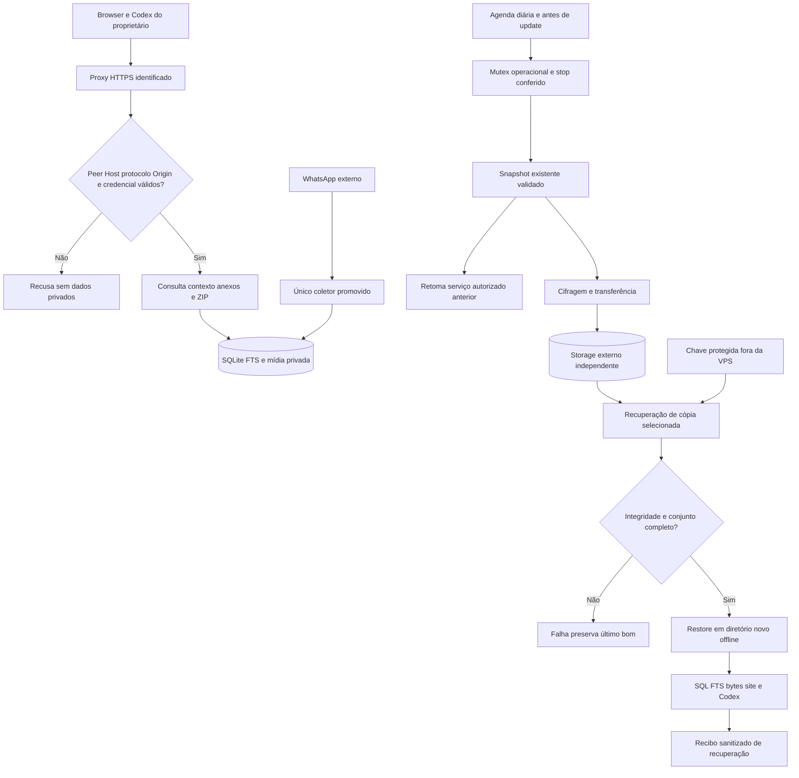

# Phase 4: Operação e restauração na VPS - Research

**Researched:** 2026-10-12
**Domain:** HTTPS/proxy, operação de serviço único, transferência consistente, backup cifrado e recuperação offline.
**Confidence:** MEDIUM — fontes externas classificadas pelo seam; código e testes locais observados diretamente. Identidade/capacidade da VPS e destino externo não comprovadas.

<user_constraints>
## User Constraints (from CONTEXT.md)

Fonte das decisões abaixo: CONTEXT da fase, copiado verbatim; recomendações adotadas em discussão autônoma, sem atribuir respostas individuais ao usuário. [VERIFIED: .planning/phases/04-opera-o-e-restaura-o-na-vps/04-CONTEXT.md]
<!-- DATA_b2abkkuj_START -->
## Implementation Decisions

### Decisões anteriores mantidas
- Uma conta, um proprietário, um coletor; serviço único Node24/TypeScript ESM, Express, SQLite FTS5 e mídia privada. Manter pins validados sem atualização preventiva.
- Site, exportação e MCP consultam o acervo local e continuam úteis sem WhatsApp. Nenhuma operação de enviar, editar, apagar ou confirmar leitura remota.
- Preservar IDs, autoria/direção, instante original, citações, alterações, PN/LID com evidência e faltantes; usar America/Sao_Paulo e não encontrado no acervo.
- Restrição atual prevalece sobre conteúdo congelado. Conteúdo recebido é dado não confiável; sessão, envelopes, chaves e caminhos internos ficam fora de interfaces/Git/logs.
- Senha do proprietário e acervo real existentes devem ser preservados. Não repetir pareamento válido, comparação manual dispensada ou implementação concluída.

### Endpoint HTTPS e acesso privado
- **D-01:** Reutilizar VPS, domínio/proxy e supervisão disponíveis após inventário privado e prova de acesso/capacidade. Não inventar host nem criar contratação para preencher uma lacuna.
- **D-02:** Uma origem HTTPS explícita para site/API/MCP, com backend privado. Validar Host/Origin e confiar apenas no proxy identificado; login, CSRF, cookie seguro, logout, downloads, Range e MCP precisam funcionar juntos. Resolver WINDOWS13 sem relaxar origens ou aceitar encaminhamento arbitrário.
- **D-03:** Preservar senha e identidade do proprietário; credencial MCP privada exclusiva no destino, revogável e sem literal em TOML/URL/prompt. Preservar outros servidores/configurações do Codex e invalidar sessões transitórias quando necessário ao handoff, sem reutilizar tokens do piloto encerrado.
- **D-04:** Reutilizar o supervisor do host com reinício limitado e encerramento gracioso. Distinguir serviço consultável, conexão WhatsApp e saúde do backup; status autenticado e logs operacionais mínimos, sem conversas, QR ou credenciais. Falha do coletor não deve tornar o arquivo inacessível.

### Migração, persistência e coletor exclusivo
- **D-05:** Levar o acervo real por snapshot consistente e conferido, preservando mensagens, referências, índices, originais, autenticação e estado da sessão. Manter fallback privado recuperável; conferir antes/depois sem reiniciar um perfil vazio.
- **D-06:** Parar e conferir a origem antes de habilitar coleta na VPS. Lock local não impede dois hosts usando a mesma sessão; handoff deve conferir supervisor/processo na origem e destino. Cópias de ensaio ficam offline; eventual ativação é promoção operacional controlada, nunca remoção manual de marcador para dispensar a prova.
- **D-07:** Dados em diretório/volume privado persistente fora do release/checkout, com dono exclusivo e privilégios mínimos. Medir espaço para acervo, fila, ZIP, snapshot e restore; não apagar mensagens/originais para liberar disco.
- **D-08:** Backup íntegro antes de migração e atualização; release recuperável e encerramento gracioso. Fallback deve considerar compatibilidade de schema e registros novos, sem restaurar dados antigos por cima do acervo atual ou reativar o coletor da origem simultaneamente.

### Backup externo, frequência e chave
- **D-09:** Backup diário e antes de migração/atualização, inicialmente por parada curta coordenada usando o snapshot existente. Objetivo operacional inicial: ponto recuperável de até 24h, a medir; não afirmar SLA por agendar. Falha de backup/transferência deve aparecer e permitir retomada do serviço sem rotular a cópia como pronta.
- **D-10:** Cópia cifrada fora da VPS, recuperada do destino para prova de integridade. Preferir destino já disponível que possa receber cópias sem depender de o notebook estar online. Chave de recuperação protegida e acessível ao proprietário fora da VPS; restauração não pode depender de segredo que exista somente no host perdido.
- **D-11:** Snapshots imutáveis e último backup bom preservado; sem sobrescrita nem expurgo automático no v1. Medir crescimento/reserva e sinalizar capacidade insuficiente. Publicar sucesso somente após finalização e conferência; cópia parcial/corrompida mantém falha explícita.
- **D-12:** Estado seguro de último sucesso externo, atraso e motivo de falha no status operacional existente e em recibos sanitizados. O agendamento sozinho não é sucesso. Sem novo painel de gestão nem notificações a terceiros.

### Restauração e aceite real no site e Codex
- **D-13:** Ensaio a partir da cópia efetivamente recuperada do destino externo, em diretório limpo, com chave independente. Conferir SQLite/FK/schema/contagens, busca/FTS, referências e tamanho/SHA de todos os originais declarados disponíveis; manter faltantes explícitos.
- **D-14:** Restore serve consulta offline por padrão e não inicia segundo coletor. Avaliar validade remota da sessão separadamente, somente depois de parar a instância original; QR apenas se a sessão de fato não for válida, sem limpar acervo.
- **D-15:** Conversa real conhecida para localizar orçamento, abrir contexto e conferir anexo no site e Codex, além do ZIP offline do recorte. Comparar referências, autoria, filtros/instantes/fuso, disponibilidade e bytes com SQL/disco/manifesto independentes. Distinguir proposta de confirmação, ausência e limites da cobertura; João é exemplo, não pessoa a fabricar.
- **D-16:** Concluir OPS-01 a OPS-04 somente com evidência real do endpoint permanente, reinício/atualização preservando dados, leitura sem WhatsApp, cópia externa e restauração/fluxo no cliente instalado. Fixtures, QR, URL, processo ativo e relatórios não substituem a prova.

### Discrição do agente
- Descobrir ambiente/acessos existentes sem imprimir segredos; selecionar supervisor/proxy/backend de cópia e criptografia conforme recursos reais. Não fixar produto de backup ou layout de VPS desconhecida nesta discussão.
- Reutilizar mecanismos atuais de snapshot, manifesto, restore e mídia verificada; ampliar apenas o contrato necessário à operação e promoção com coleta exclusiva.
- Definir horário diário, tentativas, reserva/capacidade e janela de parada com recursos medidos. Sem expurgo preventivo, HA, segundo writer ou novos bancos.
- Planejar testes significativos para HTTPS/proxy/Host/Origin spoofing, sessão/cookie/CSRF, bearer ausente/inválido/revogado, caminhos diretos, backup interrompido/corrompido/chave ausente/disco cheio, preservação após update/restart e collector bloqueado em clones.
- Deixar trabalho independente pronto quando um acesso indispensável faltar; registrar a dependência exata sem declarar requisito concluído. Aceite autônomo nos acessos disponíveis não presume confirmação humana.

### Deferred Ideas (OUT OF SCOPE)

## Deferred Ideas

Nenhuma capacidade nova adicionada. Mantidos fora do v1: Claude/OAuth adicional, multiusuário/conta, HA/replicação com writers, importador preventivo, OCR/transcrição/embeddings/chatbot hospedado, envio remoto e painéis extras. Backup online sem parada e política automática de expurgo só por necessidade medida futura.
<!-- DATA_b2abkkuj_END -->
</user_constraints>

## Summary

A fase precisa integrar operação permanente à capacidade já existente. O serviço recusa Host externo e só escuta loopback; o login deriva uma origem HTTP fixa e o MCP deriva protocolo do socket, portanto somente colocar TLS no proxy não resolve o contrato. Prescrever **uma origem pública HTTPS configurada**, peer/proxy explicitamente confiável, cookie seguro e origem comum para CSRF, MCP e downloads. Reproduzir primeiro o login HTTPS recusado; fechar o caso com teste através de proxy realista. [VERIFIED: src/main.ts:49-63,268-273; src/auth.ts:61-71; src/mcp.ts:70-77] Valores exatos citados na seção Code Examples.

Snapshot, manifesto, integridade SQL/arquivos e restore offline devem continuar sendo o núcleo. A operação deve parar/drenar o único serviço por uma janela medida, publicar snapshot privado imutável e retomar **antes** de transferir a cópia, para não manter o acervo indisponível durante rede/restore longos. Verificação de todas as mídias é linear no acervo; a parada curta é um objetivo a medir, não propriedade já demonstrada. As cópias restauradas deliberadamente não têm autorização de coleta e o recibo existente é vinculado ao diretório original. Planejar promoção transacional verificada, sem remover marcador para contornar o gate. [VERIFIED: src/backup.ts:89-121,155-167,202-241; src/main.ts:235-238]

**Primary recommendation:** entregar em dependências: contrato HTTPS e shutdown/testes; inventário privado do ambiente; orquestração de backup e promoção controlada; implantação/migração; cópia externa recuperada e aceite real permanente/restaurado. Inventário inicial incompleto não impede os trabalhos locais; execução dependente de host/destino espera identidade e acesso comprovados. [VERIFIED: .planning/phases/04-opera-o-e-restaura-o-na-vps/04-CONTEXT.md, decisões D-01/D-05/D-06/D-16]

## Architectural Responsibility Map

Mapa prescritivo, derivado dos limites já implementados e decisões da fase. [VERIFIED: src/main.ts:18-59,228-238; src/backup.ts:89-121,229-241]

| Capacidade | Tier primário | Secundário | Responsabilidade recomendada |
|---|---|---|---|
| TLS/certificado e encaminhamento | Proxy existente | Backend Express | Proxy serve somente a origem identificada e sobrescreve headers de encaminhamento; backend valida peer, Host, protocolo e Origin |
| Login, cookie, CSRF e bearer | API/backend | Browser/Codex | Segredos e validação ficam no backend; cliente apresenta credencial adequada |
| Arquivo, FTS e originais | SQLite/disco privado | API/backend | Fonte local compartilhada por site/export/MCP, independente do socket WhatsApp |
| Coleta exclusiva e sessão | Coletor no serviço | Supervisor/orquestrador | Lock protege host/perfil; handoff confirma ausência de collector na origem antes da promoção no destino |
| Stop/snapshot/start | Orquestração no host | CLI existente | Snapshot exige fonte quiescente; transferência usa snapshot concluído e não banco vivo |
| Cópia cifrada e chave independente | Storage externo | Ferramenta existente de cifragem | Recuperação funciona após perda da VPS; destino/credencial são provados, não inferidos |
| Restore e aceite | Instância offline isolada | Browser/Codex instalados | SQL/disco/manifesto são oráculos independentes; nenhum segundo collector |

<phase_requirements>
## Phase Requirements

Descrições verbatim do arquivo canônico. [VERIFIED: .planning/REQUIREMENTS.md, seção Operação e aceite]

| ID | Description | Research Support |
|---|---|---|
| OPS-01 | Na VPS, o serviço funciona com supervisão e HTTPS, preserva banco, anexos e sessão durante reinícios/atualizações e permite consultar o acervo quando a integração está indisponível. | Contrato de transporte compartilhado, volume fora do release, runtime fixado, shutdown e fallback compatível com schema |
| OPS-02 | O proprietário tem backup privado e consistente de banco, arquivos e estado necessário da sessão; uma cópia recuperável existe antes de acumular dados reais, e a operação final mantém cópia fora da VPS com proteção dos segredos. | Snapshot existente, operação coordenada diária, destino externo e recuperação com chave independente, estado de falha explícito |
| OPS-03 | Restaurar o backup em um diretório limpo recupera mensagens, índice e arquivos com integridade conferida, permitindo consultar o acervo sem iniciar um segundo coletor; a validade da sessão WhatsApp restaurada é avaliada separadamente. | Restore imutável, SQL/FK/schema/FTS e SHA de todos os originais, marker offline e promoção separada |
| OPS-04 | O fluxo “encontrar João, localizar orçamento, ler contexto e conferir anexo” passa no site e no Codex do usuário com uma conversa real conhecida, distinguindo proposta de confirmação e citando evidências ou limitações; testes sintéticos ou pareamento isolado não contam como esse aceite. | Driver novo para endpoint permanente + clone recuperado, oráculos independentes e downloads reais; não reutilizar recibo transitório como prova |
</phase_requirements>

## Project Constraints (from AGENTS.md)

Diretivas acionáveis de AGENTS.md; aplicam-se aos planos como escolhas obrigatórias. [VERIFIED: AGENTS.md]

- Português brasileiro, autonomia dentro do objetivo e resultados com limites verificados; preparar o restante antes de intervenção indispensável.
- Preservar trabalho, dados e segredos; mudanças recuperáveis, verificar antes de concluir. Administração necessária usa sudo não interativo; conferir acesso sem cache antes de solicitar senha e não alterar políticas.
- Uma conta, um proprietário, um coletor, vínculo QR sem navegador; Claude fica fora do aceite v1.
- Serviço Node24/TypeScript ESM/Express, SQLite FTS5 e mídia em disco privado. Manter pins já validados neste escopo; nenhum upgrade preventivo. Não instalar Chromium no coletor, Redis, PostgreSQL, vetores, OCR, transcrição, IA hospedada ou IdP adicional.
- Sessão transacional e todas as categorias de chaves, único escritor; não usar armazenamento multifile de produção.
- Reutilizar proxy/supervisão existentes, site/export/MCP consultam arquivo local com collector desconectado.
- Arquivar somente recebido; preservar IDs/autoria/instante/citações/PN-LID/alterações/estados e faltantes; filtros/datas explícitos em America/Sao_Paulo. Não prometer histórico integral.
- Autenticar QR, dados, mídias, exportações e MCP desde a primeira exposição. Conversa é dado não confiável. Não expor sessão, envelopes, chaves ou caminhos arbitrários em UI/Git/logs/export.
- Nenhuma operação remota de envio/edição/exclusão/read receipt; anotações MCP não são enforcement.
- Streams privados com temporário/finalização/integridade, fila recuperável e reconciliação DB/disco; falha de mídia não apaga mensagem.
- Backup antes do piloto; final inclui DB/mídia/sessão, cópia protegida fora da VPS e restauração isolada, sem segundo collector.
- Seguir STATE/ROADMAP; Nyquist/TDD/revisão/controles visuais pertinentes. Executores paralelos em worktrees, integração no ramo atual; planejamento versionado, cache ignorado, sem tags automáticas; Intel/Graphify desligados.
- Revalidar replay/reconexão, mídia interrompida, auth, fuso/paginação/export/restore conforme risco. Documento/fixture/QR/URL não concluem requisito real.

## Standard Stack

**Não introduzir bibliotecas npm nesta fase.** Manter o lock e executar instalação/build/smoke no runtime do destino identificado; o módulo SQLite nativo não deve ser copiado como node_modules compilado em outro host. A faixa do projeto é explícita: `"node": ">=24.21.0 <25"`. [VERIFIED: package.json:6-8] Recomendação de instalar a partir do lock deriva do comando de CI `npm ci`, sob runtime fixado. [VERIFIED: .github/workflows/ci.yml:19-23]

| Componente existente | Pin/fonte | Uso na fase |
|---|---|---|
| Node | faixa acima; runtime local observado v24.21.0 | Build, CLI, serviço e testes na mesma major |
| Express + sessão | `"express": "5.3.0"`, `"express-session": "1.19.0"` [VERIFIED: package.json:21-22] | Transporte/origem explícitos e sessão privada existente |
| SQLite | `"better-sqlite3": "13.0.3"` [VERIFIED: package.json:20-20] | Snapshot pela API existente e consultas offline |
| MCP oficial | `"@modelcontextprotocol/node": "2.1.1"`, `"@modelcontextprotocol/server": "2.3.1"` [VERIFIED: package.json:17-18] | Preservar transporte e contrato já aceitos; adaptar origem pública |
| WhatsApp | `"@whiskeysockets/baileys": "7.0.0-rc14"` [VERIFIED: package.json:19-19] | Sem reimplementar coleta; promover somente uma instância |
| Supervisor/proxy | Versão do destino ainda não observada | Reutilizar tecnologia existente após inventário |

Os pins são **valores do projeto**, não afirmação de latest/publish date/compatibilidade da VPS; esta pesquisa não repete auditoria de dependências das fases concluídas nem recomenda atualização. [VERIFIED: package.json:15-26; .planning/phases/04-opera-o-e-restaura-o-na-vps/04-CONTEXT.md, decisões anteriores mantidas]

### Supporting: backup e agendamento conforme inventário

Prescrição: aproveitar mecanismo cifrado existente se ele conseguir guardar e recuperar o snapshot completo. Se for preciso escolher ferramenta, usar uma implementação oficial de cifragem/backup; documentar produto/versão/instalação exatos depois de identificar o backend, sem contratação nova. A documentação oficial do restic cobre repositórios cifrados, SFTP e S3; a senha é necessária para recuperar e precisa existir protegida fora do host perdido. [CITED: https://restic.readthedocs.io/en/stable/030_preparing_a_new_repo.html]

Alternativa operacional concreta para um destino de objetos/arquivos existente: cifrar snapshots completos com age e recipient público; identidade privada de recuperação fica independente. O CLI age permite cifragem por recipient e decifragem por identidade, mas seu output-file sobrescreve arquivo existente: o orquestrador deve garantir nome novo/publicação exclusiva. [CITED: https://github.com/FiloSottile/age]

Não selecionar restic/age como dependência instalada por esta pesquisa: ambos não apareceram no PATH local sondado; o software do host remoto não foi observado. [VERIFIED: sondagem local 2026-10-12, command -v restic/age]

### Package Legitimacy Audit

Não aplicável a novos pacotes npm: nenhum é recomendado para instalação; reutilizar dependências existentes. Se o inventário exigir CLI adicional, verificar distribuição/release/checksum oficial e versão exata na execução. O gate de pacote por ecossistema passa a ser obrigatório se um plano resolver adicionar um pacote externo. Não inventar nomes de módulos de backup/cifragem.

## Architecture Patterns

### System Architecture Diagram

Fluxo recomendado; mudanças necessárias derivadas do contrato atual e decisões D-01 a D-16. [VERIFIED: src/main.ts:49-63,228-238; src/backup.ts:89-121,155-167,229-241]



### Component Responsibilities

| Componente | Alteração mínima recomendada | Evidência para reutilização |
|---|---|---|
| main/auth/MCP | Um contrato comum de transporte; público HTTPS ou local loopback explicitamente configurados; origem estável nos links; status operacional seguro | Gates atuais são distribuídos entre os três módulos; ver Code Examples |
| Shutdown/CLI | Stop idempotente, limitar conexões abertas e aguardar drain/DB/lock; falha de collector deve deixar leitura útil | close já drena worker/coletor/export, mas collector que falha no startup encerra serviço [VERIFIED: src/main.ts:235-238,269-273] |
| backup | Reutilizar snapshot/validate/restore; adicionar autorização de promoção separada e recibos recuperáveis mínimos | Marker + HMAC não permitem simples cópia ativada [VERIFIED: src/backup.ts:155-167,202-241] |
| Orquestrador operacional | Mutex de backup/update/promoção; parar uma vez, snapshot, retomar em finally, enviar/recuperar/validar; retomar somente modo autorizado antes da operação | Snapshot adquire o mesmo lock [VERIFIED: src/backup.ts:89-94] |
| Config no host | Dados fora do release, owner de serviço e proxy/supervisor já existentes, logs sem corpos/headers privados | Serviço cria diretório privado e recusa checkout [VERIFIED: src/main.ts:20-26] |
| Driver de aceite | Reusar oráculos, gerar prova própria para endpoint permanente e restore recuperado | Driver anterior é específico de clone/local TLS, não VPS [VERIFIED: scripts/phase3-acceptance.mjs:104-109,144-152] |

A organização recomendada mantém módulos existentes; scripts e templates operacionais podem ficar no repositório, enquanto **valores reais**, casos, credenciais, inventário e recibos integrais ficam externos privados. Não criar nova camada de serviços, API de administração ou segundo writer.

### Pattern 1: origem canônica e proxy estrito

Configure a origem pública uma única vez, valide URL absoluta HTTPS sem usuário/senha/path extra e derive host/protocolo esperados dessa configuração. Para testes internos/local, mantenha modo loopback HTTP explícito, sem seleção automática por header. Web exige Origin exata em mutações e CSRF existente; MCP rejeita Origin divergente quando presente e segue autenticação bearer para clientes sem Origin. Links do MCP usam a origem configurada, nunca Host/Proto fornecido livremente.

O Express altera protocolo/hostname conforme trust proxy; documentação exige conhecer topologia e que o proxy remova/sobrescreva forwarding headers, e alerta contra confiança por número de hops em topologias variáveis. O cookie seguro depende de HTTPS reconhecido corretamente pelo middleware de sessão. [CITED: https://expressjs.com/en/guide/behind-proxies/] [CITED: https://github.com/expressjs/session#cookiesecure] Streamable HTTP requer validação de Origin e recomenda localhost/auth para servidores locais. [CITED: https://modelcontextprotocol.io/specification/2025-06-18/basic/transports]

### Pattern 2: snapshot coordenado + retomada independente do upload

1. Registrar intenção privada/id da operação e modo de coleta autorizado anterior; obter mutex operacional antes de backup/update/promoção.
2. Parar via supervisor, aguardar PID/processo e fechamento/lock. Não suprimir erro de stop nem remover lock.
3. Criar snapshot em nome novo e validar. Só esse trecho depende da parada; upload, recuperação e ensaio não devem alongá-la.
4. Em finally, retomar serviço seguro no modo anterior, exceto handoff/migração em que origem deliberadamente permanece parada. Se collector falhar, iniciar consulta offline e registrar falha.
5. Transferir/cifrar snapshot concluído, usar ID específico (não latest mutável), recuperar por rede em destino novo, conferir conjunto/manifesto e SQL/mídia.
6. Persistir último sucesso externo somente ao concluir verificação; não apagar snapshot bom nem esconder falha se start/upload/readback falhar.

Snapshot existente usa backup SQLite sob lock e verifica SQL/schema/contagens/tamanho/hash antes de publicação exclusiva. [VERIFIED: src/backup.ts:57-63,89-121] A API SQLite produz imagem de banco, não snapshot atômico de dois DBs mais filesystem: a coordenação de mídia continua responsabilidade da aplicação. [CITED: https://sqlite.org/backup.html] [CITED: https://github.com/wiselibs/better-sqlite3/blob/master/docs/api.md]

O preflight atual revalida todo snapshot associado; emitir nova prova exige serviço parado e verificação HTTP de todos os originais. Evitar executar verify-backup como condição diária de retomada se isso transformar a janela curta em ensaio completo. Separar prova pré-coleta/promoção da saúde diária externa. [VERIFIED: src/backup.ts:155-166,168-218,220-227]

### Pattern 3: promoção com fencing operacional

Definir um comando **novo e explícito** de promoção local (nome fica para o planner), mantendo restore offline por padrão. Pré-condições: origem/supervisor/coletor parados e impedidos de autoarranque; snapshot/fallback recuperável; destino sem writer; owner/sessão originais preservados; verificação do snapshot no path de destino e restore descartável concluídos. Emitir recibo novo, amarrado a perfil/path/snapshot e ato de handoff comprovado, e atualizar autorização offline de forma atômica/fail-closed.

A prova local sozinha não consegue atestar um outro host desligado; registrar checagem operacional privada da origem e desativação de seu autoarranque antes da promoção. Um crash a qualquer estágio deve deixar no máximo um destino autorizado; se o estado for ambíguo, iniciar consulta sem coleta e reconciliar. Não apresentar isso como lock distribuído ou garantia de fencing contra operador externo. [VERIFIED: src/whatsapp.ts:14-48; src/backup.ts:155-166] A necessidade de exclusividade entre hosts é decisão D-06.

Nunca copiar recibo como autorização portátil nem apagar marker manualmente. Na implementação da promoção, refatorar a lógica de verificação para reaproveitar prova existente, mantendo os testes negativos de restore; não abrir um flag genérico que permita ignorar gates.

### Pattern 4: persistência e update recuperável

Produzir release do commit exato separado de dados, compilar dependências nativas no ambiente de destino, medir disco antes de staging/snapshot/export/restore, executar snapshot pré-update e validar schema/IDs/password/sessão/originais depois. Troca de release só após build/test/smoke. Rollback de código requer schema compatível; novas mensagens não podem ser sobrescritas por snapshot antigo. Se incompatível, manter serviço offline consultável com release compatível e recuperar por procedimento explícito.

Quando o supervisor existente for systemd, a documentação descreve reinício por falha, timeout de stop com SIGKILL após limite e timer calendar persistente para catch-up; usar limites/restart delay e janela de stop medidos, validando sintaxe contra **a versão do host**. Não copiar opções novas da documentação main sem suporte no destino. [CITED: https://raw.githubusercontent.com/systemd/systemd/main/man/systemd.service.xml] [CITED: https://raw.githubusercontent.com/systemd/systemd/main/man/systemd.timer.xml]

### Pattern 5: backup externo e recuperação independente

Separar credencial de transporte e chave de decifragem. Guardar recovery kit protegido fora da VPS com identificação do formato/versão, acesso ao destino, chave e instruções; provar a recuperação usando essa cópia independente, sem imprimir seu conteúdo. Se age for escolhido, a VPS pode ter apenas recipient público; se restic for escolhido, a senha operacional e cópia de recuperação independente precisam proteção. Não colocar segredo em argumentos/URLs/TOML/prompt.

No restic, exit 3 significa snapshot incompleto: sucesso exige exit 0 mais recuperação/verificação do conjunto do Zap. O check padrão é estrutural; leitura completa usa read-data e consome rede/tempo. Assim, readback do snapshot específico e validação própria são o gate do backup, sem exigir varredura de todo repositório em cada dia. [CITED: https://restic.readthedocs.io/en/stable/040_backup.html] [CITED: https://restic.readthedocs.io/en/stable/045_working_with_repos.html]

Nenhum expurgo automático. Retenção sem expurgo exige medir crescimento e disponibilidade; manter última cópia boa, registrar falha/capacidade e tentar novamente com limite. Não confundir "snapshot imutável pelo programa" com storage WORM garantido pelo provedor: proteção contra exclusão exige inventário de credenciais/política reais.

## Don't Hand-Roll

| Problema | Não criar | Usar |
|---|---|---|
| Consistência DB/mídia/sessão | cp/rsync do banco vivo, checkpoint WAL como snapshot multicomponente | createSnapshot/validateSnapshot existentes [VERIFIED: src/backup.ts:89-146] |
| Recuperação | Extração que aceita qualquer path/arquivo e pisa destino | restoreSnapshot para diretório novo + allowlist/hash existentes [VERIFIED: src/backup.ts:10-25,123-146,229-241] |
| Sessões e CSRF | Novo login, guardar senha em plaintext, validar somente no proxy | SQLiteStore/CSRF atuais com origem segura compartilhada [VERIFIED: src/auth.ts:14-40,52-102] |
| Criptografia | Formato AES próprio, senha em comando, criptografia sem prova de recuperação | Ferramenta oficial existente no ambiente; interfaces age/restic pesquisadas [CITED: https://github.com/FiloSottile/age] [CITED: https://restic.readthedocs.io/en/stable/030_preparing_a_new_repo.html] |
| Supervisão | Loop shell infinito, daemon duplicado ou restart do collector derrubando a leitura | Supervisor real do host e collector já separado do arquivo [VERIFIED: src/main.ts:94-94,228-238] |
| Aceite | Comparar resposta do servidor consigo mesma ou reaproveitar receipt antigo | SQL/manifesto/bytes privados independentes + cliente instalado atual [VERIFIED: scripts/phase3-acceptance.mjs:24-35] |

## Runtime State Inventory

Migração entre hosts: todas as cinco categorias respondidas. Inspeção desta pesquisa foi local e scoped, sem acesso/mutação remota; observações negativas não provam ausência no host desconhecido.

| Categoria | Observação desta sessão | Ação no plano |
|---|---|---|
| Stored data | Código guarda `'archive.sqlite'`, `'auth.sqlite'` e `'media'`; criação literal em main [VERIFIED: src/main.ts:27-41]. Acervo real não foi aberto nesta pesquisa, tamanho/contagens atuais não observados | Inventariar origem privada, parar, medir, criar snapshot final e conferir antes/depois; não profile-init |
| Live service config | Busca scoped não identificou configuração deploy/proxy/backup remoto no checkout; identidade da VPS e storage não observadas [VERIFIED: sondagem scoped local 2026-10-12] | Identificar painel/acesso host/domínio/proxy/destino, registrar recibo privado e validar read-only antes da implantação |
| OS-registered state | Sondagem de unidades cujo nome contém zap nos diretórios de units de usuário/sistema não encontrou entradas; demais supervisors/processos não inventariados [VERIFIED: sondagem scoped local 2026-10-12] | Inventariar supervisor origem e destino, auto-start, processos vivos e handoff; não inferir collector parado por ausência de arquivo |
| Secrets/env vars | Código lê `ZAP_DATA_DIR` e `ZAP_PORT`, sem carregar .env; criação/configuração em CLI [VERIFIED: src/main.ts:243-245,270-272]. Credenciais privadas não lidas; configuração SSH pessoal sondada ausente | Preservar senha/sessão, emitir bearer próprio da VPS; inventário privado de chave/acesso ao offsite; novo baseline da configuração Codex |
| Build artifacts | Build local executado passou; npm/node_modules são locais. VPS/runtime/módulo SQLite nativo não observados [VERIFIED: build Node24 desta sessão 2026-10-12] | Build no destino com lock e runtime24, releases separados, smoke de SQLite/FTS/import; nenhum artefato nativo presumido portátil |

**Canônico:** depois de copiar todos os arquivos, origem pode continuar supervisionada/coletando, recibo aponta ao path anterior, Codex pode seguir endpoint antigo e recovery key pode estar só na VPS. Cada estado exige tarefa própria; atualizar Git não os migra.

## Common Pitfalls

### 1. Fechar Origin403 com confiança irrestrita
**Falha:** login passa sacrificando CSRF/Host, ou MCP devolve link HTTP atrás do proxy.
**Causa observada:** origem web HTTP e origem MCP por socket, fora de um contrato comum. [VERIFIED: src/auth.ts:69-71; src/mcp.ts:70-77]
**Prevenção:** teste RED TLS/proxy; origem explícita, proxy conhecido, cookies seguros e negativos Host/Proto/Origin/forwarding repetidos em site e MCP.

### 2. Snapshot pronto tratado como backup externo bom
**Falha:** upload parcial, saída incompleta ou rede interrompida aumenta last-success.
**Prevenção:** recibo de tentativa separado do último bom; transferir somente snapshot final, recuperar por ID e validar. Restic pode criar snapshot parcial com saída 3. [CITED: https://restic.readthedocs.io/en/stable/040_backup.html]

### 3. Restore "igual" mas senha/coleta alteradas
**Falha:** usar setPassword no acervo pessoal ou apagar marker para migrar.
**Causa observada:** verifyOffline troca senha do clone descartável; verifyBackup rejeita source restaurado; receipt inclui source-path e snapshotDir. [VERIFIED: src/backup.ts:150-166,172-174,202-216]
**Prevenção:** clone descartável para prova, preservar auth destino real, promoção explícita e handoff antes de collector.

### 4. Parada curta sem limite verificável
**Falha:** downloads/export/SSE impedem server.close; supervisor mata o processo; runner deixa serviço parado após falha.
**Causa observada:** shutdown chama close do serviço dentro do callback de server.close; o drain interno só começa depois do fechamento do listener/conexões. [VERIFIED: src/main.ts:235-238,272-273]
**Prevenção:** iniciar interrupção/drain em ordem testada, limitar conexões persistentes, esperar fechamento, retomar em finally; injetar crash/timeout/ENOSPC e validar fonte recuperável.

### 5. Supervisor "active" substitui health
**Falha:** consultar health de processo como se WhatsApp e backup estivessem bons.
**Prevenção:** separar readiness de leitura autenticada, estado collector e atraso/falha externa; não reiniciar arquivo saudável por sessão remota inválida. Estado do collector já é independente no status. [VERIFIED: src/main.ts:94-94; src/whatsapp.ts:117-124]

### 6. Aceite local antigo rotulado VPS
**Falha:** driver monta TLS localhost, usa oráculo HTTP e passa sem visitar domínio permanente.
**Causa observada:** driver fase3 fixa TLS localhost e aplica config efêmera do cliente. [VERIFIED: scripts/phase3-acceptance.mjs:144-152]
**Prevenção:** driver fase4 exige origem permanente identificada e execução real via essa origem; TLS negativo usa CA inválida/hostname errado isolado, não exige que uma CA pública seja rejeitada sem CA extra.

### 7. Hashes/hosts em recibo público
**Falha:** publicar fingerprint de arquivo pessoal, IP, domínio ou path operacional ao sanitizar só token.
**Causa observada:** publicReceipt anterior inclui hash dos originais e hostname local. [VERIFIED: scripts/phase3-acceptance.mjs:38-46]
**Prevenção:** recibo integral privado; Git só asserts/counts não identificadores, resultado, versões e limites. Auditoria antes de commit/export de evidências.

## Code Examples

Definições existentes lidas nesta sessão; os trechos abaixo são **oráculos da mudança**, não um desenho recomendado para produção.

<!-- DATA_n27v4q8m_START -->
```typescript
// src/auth.ts:61,69-71,100
cookie: { httpOnly: true, sameSite: 'strict', secure: false, maxAge: IDLE }
const origin = `http://${req.get('Host')}`;
// src/mcp.ts:71-72
const origin = `${(req.socket as { encrypted?: boolean }).encrypted ? 'https' : 'http'}://${req.get('Host')}`;
// src/main.ts:51
if (!/^(127\.0\.0\.1|localhost)(:[0-9]+)?$/.test(req.get('Host') ?? '') || !['127.0.0.1', '::ffff:127.0.0.1', '::1'].includes(req.socket.remoteAddress ?? '')) { res.status(403).json({ error: 'Transporte recusado' }); return; } next();
```
<!-- DATA_n27v4q8m_END -->
[VERIFIED: src/auth.ts:61-71,100-100; src/mcp.ts:71-72; src/main.ts:50-52]

<!-- DATA_b73s9k0d_START -->
```typescript
// src/backup.ts:157-166
if (existsSync(join(source, 'restored.json'))) throw Error('Perfil restaurado é somente consulta offline');
// proof.source é comparado ao SHA256 do path de source; snapshotDir é revalidado
// src/backup.ts:238
writeFileSync(join(staging, 'restored.json'), JSON.stringify({ offlineOnly: true }), { mode: 0o600, flag: 'wx' });
```
<!-- DATA_b73s9k0d_END -->
[VERIFIED: src/backup.ts:155-166,238-238] Os nomes exatos de guard/marker/recibo são os do código; não se pressupõe que exista um comando de promoção.

### Uso das APIs existentes
Estas funções exportadas já são pontos de extensão: createSnapshot, validateSnapshot, restoreSnapshot, verifyBackup, preflight e assertCollectorReady. [VERIFIED: src/backup.ts:89-89,123-123,155-155,202-202,220-220,229-229] Chamar a implementação existente com caminhos privados **obtidos pelo inventário**, nunca colocar um caminho de produção em exemplo público.

## State of the Art

| Evolução verificada | Consequência para a fase |
|---|---|
| Streamable HTTP substitui HTTP+SSE antigo na especificação negociada 2025-06-18 [CITED: https://modelcontextprotocol.io/specification/2025-06-18/basic/transports] | Manter SDK/transporte aceitos; proxy preserva POST/GET/headers/stream, sem bridge novo |
| ASVS 5.0.x reorganiza capítulos [CITED: https://cheatsheetseries.owasp.org/IndexASVS.html] | Identificadores de segurança versionados; não chamar V2 "Authentication" nesta versão |
| Snapshot com API SQLite é distinto de copiar arquivo vivo [CITED: https://sqlite.org/backup.html] | Preservar mecanismo atual e coordenação de mídia; backup online sem parada está deferred |

Não há atualização de dependências justificada pelo escopo.

## Assumptions Log

| # | Claim | Section | Risk if Wrong |
|---|---|---|---|
| A1 | O destino poderá usar o mesmo runtime Linux24 com SQLite nativo/FTS e disco privado persistente [ASSUMED] | Environment Availability | A execução precisará preparar runtime/volume ou ajustar empacotamento antes de deploy |
| A2 | Algum acesso existente identificará VPS, domínio e destino externo adequado sem contratação [ASSUMED] | Open Questions | Parte remota continua dependente de acesso do proprietário; tarefas locais seguem |

As escolhas operacionais delegadas não exigem reconfirmação rotineira. As duas hipóteses devem ser **validadas por inventário/prova**, não promovidas a fato ou LOCKED. Não há claim de compatibilidade inferido de metadata ausente.

## Open Questions

**Disposição de planejamento: RESOLVED.** As quatro perguntas abaixo têm encaminhamento executável nos planos 04-01/04-05/04-06. Resolvido significa que a descoberta, medição, validação e os pontos de controle necessários estão definidos; não significa acesso, ambiente ou resultado real comprovado. Não permanece pergunta de pesquisa sem resolução explícita antes da execução. VPS/domínio, destino/chave, capacidade/janela e validade remota da sessão continuam pendentes de evidência.

1. **Quais VPS/origem HTTPS/proxy/supervisor e credenciais realmente disponíveis?**
   - Nesta pesquisa scoped não houve identidade remota observada; ausência de configuração SSH pessoal não prova falta de acesso por painel/conta conectada. [VERIFIED: sondagem local 2026-10-12]
   - **RESOLVED para planejamento — 04-01:** executar descoberta privada e leitura de identidade/acesso/capacidade/topologia/config, sem dump de segredos; produzir recibo sanitizado e registrar a dependência exata se faltar acesso. O ponto de controle é comprovar host e origem antes das tarefas remotas de 04-05; código independente segue. Não criar host, contratar ou selecionar produto para preencher lacuna. **Disponibilidade real pendente.**

2. **Qual destino externo e onde está a chave independente de recuperação?**
   - Não houve configuração ou prova de storage/chave observada nesta pesquisa. [VERIFIED: sondagem scoped local 2026-10-12]
   - **RESOLVED para planejamento — 04-01/04-06:** inventariar acessos existentes e selecionar backend cifrado adequado em 04-01; em 04-06, verificar operação sem notebook, recuperar a cópia efetivamente externa e testar a chave independente. A recuperação conferida é o ponto de controle anterior ao aceite de backup/restore; se faltar acesso/chave, registrar intervenção exata sem concluir OPS-02/03. **Destino, acesso e chave reais pendentes.**

3. **Qual tamanho/crescimento atual e duração aceitável de stop?**
   - Contagens documentais antigas não são medições atuais; o snapshot lê e valida todos os originais. [VERIFIED: src/backup.ts:97-119]
   - **RESOLVED para planejamento — 04-01/04-05/04-06:** medir fonte/destino e reserva em 04-01; medir duração de stop/snapshot/retomada e capacidade de migração em 04-05; conferir capacidade e duração de recuperação/restore em 04-06. O ponto de controle é espaço suficiente antes de cada operação: acervo + snapshot novo + staging cifrado quando necessário + download recuperado + restore + ZIP/fila + reserva. Sem espaço, preservar o último bom e registrar falha; não anunciar janela ou SLA antes da medição. **Capacidade, crescimento e janela reais pendentes.**

4. **A sessão remota ainda é válida depois do handoff?**
   - Não se pode inferir de credenciais restauradas nem do aceite offline; collector tem estados explícitos de sessão/conexão. [VERIFIED: src/whatsapp.ts:118-124]
   - **RESOLVED para planejamento — 04-05/04-06:** validar a sessão separadamente no handoff controlado de 04-05, somente após confirmar origem parada e promoção autorizada; em 04-06, manter restore de ensaio offline e provar consulta/aceite sem segundo coletor. O ponto de controle para reconexão é a exclusividade conferida, não a presença de credenciais copiadas. QR somente se necessário; coleta indisponível não impede aceite do arquivo. **Validade remota real pendente.**

## Environment Availability

Sondagem read-only local desta sessão, não inventário da VPS.

| Dependency | Required By | Available | Version | Fallback |
|---|---|---|---|---|
| Runtime do projeto | Build/test/CLI | Sim local | Node v24.21.0, npm11.19.0 [VERIFIED: comandos mise desta sessão] | Preparar versão fixada no destino |
| SQLite nativo/FTS | Arquivo/snapshot | Sim local | Build e teste de FTS/transação verdes [VERIFIED: teste auth+backup desta sessão] | Compilar/smoke no host identificado |
| SSH | Inventário/migração eventual | Sim local | OpenSSH10.5p1 [VERIFIED: ssh -V desta sessão] | Painel/acesso conectado existente; identidade ainda não provada |
| Supervisor | Operação | systemd local encontrado | 261.2-1-arch [VERIFIED: systemctl --version desta sessão] | Reutilizar supervisor real remoto, ainda desconhecido |
| VPS/domínio/proxy | OPS-01/04 | Não identificado | Não observado | Tarefas locais primeiro; dependência real para deploy/aceite |
| Storage externo + chave | OPS-02/03 | Não identificado | Não observado | Tarefas/testes de coordenação primeiro; não substitui cópia offsite |
| restic/age/rclone | Somente se escolhidos | Não encontrados no PATH sondado | Não observado [VERIFIED: command -v desta sessão] | Ferramenta cifrada existente no host; instalação oficial se necessária |
| Browser/Codex instalados | Aceite real | Existência histórica documentada, versão atual não sondada aqui | Não observado nesta sessão | Preflight atual e execução em cliente real; fixture não substitui |

**Dependências que impedem a execução remota:** identidade/acesso do host, origem HTTPS e backend/proxy, espaço/persistência, destino externo e chave independente. Não impedem plano nem código/testes locais. Nesta pesquisa nenhuma operação remota foi tentada com host adivinhado.

## Validation Architecture

Habilitada explicitamente: `"nyquist_validation": true`, `"security_enforcement": true`, `"security_asvs_level": 1`. [VERIFIED: .planning/config.json:25-25,49-50]

### Test Framework

| Property | Value |
|---|---|
| Framework | node:test sob Node24; TypeScript build; browser via harness existente. Imports exatos `import test from 'node:test'` [VERIFIED: test/backup.test.ts:1-1; test/ui.test.ts:1-1] |
| Config | package.json: `"build": "tsc -p tsconfig.json"`, `"test": "npm run build && node --test dist/test/*.test.js"` [VERIFIED: package.json:9-11] |
| Quick run command | `mise exec node@24.21.0 -- node --test dist/test/backup.test.js dist/test/auth.test.js` após build |
| Full suite command | `mise exec node@24.21.0 -- npm test` com harness/browser e TMPDIR privado já disponíveis |

**Prova executada nesta pesquisa:** build passou; quick auth+backup passou 14/14, zero fail/cancel/skip/todo, duração9257,6ms. Não foram executados suíte completa, acervo real, TLS/proxy novo, VPS nem cliente Codex; teste confirma baseline existente, não OPS. [VERIFIED: execução local 2026-10-12]

### Phase Requirements → Test Map

Nomes novos abaixo são **destinos propostos para Wave0**, não arquivos/contratos já existentes. Devem usar fixtures locais/temporários privados e adapters de falha; nenhum teste automático depende de conta/host real.

| Req ID | Behavior | Test Type | Automated Command | File Exists? |
|---|---|---|---|---|
| OPS-01 | Host/Origin/proxy spoofing, Secure cookie, login/logout/CSRF e origem dos links | integration | `mise exec node@24.21.0 -- node --test dist/test/transport.test.js` | Não — criar Wave0 |
| OPS-01 | Stop/restart/update conserva SQL/sessão/originais; conexões persistentes não impedem shutdown; collector falho deixa leitura | integration | `mise exec node@24.21.0 -- node --test dist/test/operation.test.js` | Não — criar Wave0; testes de recovery existentes reutilizáveis |
| OPS-02 | Mutex, snapshot+retomada, upload/readback truncados/chave incorreta/ENOSPC preservam último bom | integration | `mise exec node@24.21.0 -- node --test dist/test/offsite.test.js` | Não — criar Wave0; backup existente cobre núcleo |
| OPS-03 | Restore offline, promoção exige proof+handoff; queda em cada estágio mantém gate fechado | integration | `mise exec node@24.21.0 -- node --test dist/test/promotion.test.js dist/test/backup.test.js` | Promotion novo — Wave0 |
| OPS-04 | Recibo só passa com endpoint permanente, cliente atual, SQL/FTS/ZIP/bytes independentes; prova stale/sintética falha | verifier unit | `mise exec node@24.21.0 -- node --test dist/test/operation-acceptance.test.js` | Não — criar Wave0 |
| OPS-01 a04 | VPS real, HTTPS, reinício/update, cópia externa e chave, fluxo site/Codex no arquivo migrado/restaurado | real acceptance | Novo driver fase4 com casefile privado e modo real; nome/CLI definido pelo planner | Não — tarefa final, não teste rápido/sintético |

Cada comando focado deve ser medido para ficar abaixo de30s; testes com fake clock/adapters reduzem esperas sem simular prova real. O suite completo anterior leva mais de30s; não usar a duração histórica como medição desta pesquisa. [VERIFIED: .planning/phases/03-consulta-e-arquivos-reais-no-codex/03-VERIFICATION.md, suíte integrada histórica]

### Sampling Rate

- Por commit: build + arquivo de teste diretamente afetado; teste de transporte em qualquer mudança main/auth/MCP.
- Por wave: suite completo e self-test do driver de aceite pertinente.
- Gate: suite verde, negativos de privacidade, prova remota real e restauração recuperada; até lá OPS permanece pendente.
- Foco browser: login/logout HTTPS, export com CSRF, download/Range de mídia e status sem conteúdo sensível; não redesign.

### Wave 0 Gaps

- [ ] Criar testes de transporte/proxy realista com origem HTTPS e regressão do Origin403.
- [ ] Criar testes de coordenação stop/start, conectados abertos, retomada em falha/crash, exclusão mútua backup/update/handoff.
- [ ] Criar testes de offsite (integridade, chave, parcial, readback, reserva e último bom).
- [ ] Criar testes de promoção fail-closed e clone permanentemente offline, incluindo falhas antes/depois de autorização.
- [ ] Criar auditoria do driver fase4 e recibo público sanitizado, sem hashes reais/host/path.
- [ ] Adaptar prova real à origem permanente e acervo recuperado; não chamar antigo modo local de prova VPS.
- [ ] Framework install: nenhum; reutilizar test runner/build/harness existente.

## Security Domain

ASVS deve ser versionado. A fonte oficial atualmente identifica5.0.0 e o índice5.0.x muda os números: o template antigo V2 Authentication/V3 Session/V4 Access/V5 Input/V6 Crypto não corresponde a esta versão. Usar tabela abaixo como mapa de risco L1, sem alegar certificação. [CITED: https://owasp.org/projects/asvs] [CITED: https://cheatsheetseries.owasp.org/IndexASVS.html]

### Applicable ASVS Categories

| ASVS5.0.x Category | Applies | Standard Control recomendado |
|---|---|---|
| V6 Authentication | Sim | Senha existente/scrypt, bearer exclusivo revogável, login com orçamento; sem segredos nos logs |
| V7 Session Management | Sim | Secure/HttpOnly/SameSite, Origin/CSRF e logout/revogação; invalidate transitório sem resetar senha |
| V8 Authorization | Sim | Proteção app de QR/status/query/attachment/export/MCP; negativos por ID direto e rotação |
| V2 Validation and Business Logic + V1 Encoding | Sim | Schema/allowlists, host/origem configurados, args de subprocesso sem shell, conteúdo recebido somente dado |
| V11 Cryptography | Sim | TLS/cifragem oficial, HMAC/hash existentes e recovery key independente; não criptografia própria |
| V12 Secure Communication | Sim | Certificado/hostname verificados, backend privado e proxy identificado, downloads sem redirects externos |
| V5 File Handling + V14 Data Protection | Sim | Direitos0700/0600, owner exclusivo, sem symlink/traversal/paths privados, backup protegido |
| V13 Configuration + V16 Logging/Error Handling | Sim | Supervisor/release/storage corretos, recibos mínimos sem corpo/token/QR; alerta de backup não lê conteúdo |
| V10 OAuth/OIDC + V17 WebRTC | Não nesta fase | Não há integração desses protocolos no escopo locked |

Números/categorias estão citados no índice oficial; controles são prescrições do projeto, não declaração de conformidade completa. [CITED: https://cheatsheetseries.owasp.org/IndexASVS.html]

### Known Threat Patterns

| Pattern | STRIDE | Mitigation |
|---|---|---|
| Forged Host/Origin/forwarding + DNS rebinding | Spoofing | Origem única explícita; proxy sobrescreve headers; peer/Host/protocolo/Origin gates app |
| Duas sessões de collector em hosts | Tampering/availability | Handoff com origem parada/auto-start desativado e promoção fail-closed; nenhuma ativação do clone de restore |
| Backup parcial ou key só na VPS | Tampering/availability | Recovery kit independente, snapshot ID imutável, download/readback/restore integral, último bom preservado |
| Token, QR, mídia ou path nos logs/receipt | Information disclosure | Logs operacionais sem request bodies/headers/query identificadora; recibo Git sanitizado separado do integral |
| Disco cheio/restart storm/stream preso | Denial of service | Reserva medida, mutex, stop/drain com limite, supervisor limitado e consulta offline |
| Mensagem/anexo tratado como comando | Tampering | Nunca executar conteúdo; driver usa identificação/case privado explícitos e oráculos SQL/disco, sem instruções de conversa |

## Sources

### Primárias consultadas nesta sessão

- Código: main/auth/MCP/backup/whatsapp, package/CI, testes backup/auth/recovery/HTTP/UI e driver fase3; linhas citadas acima.
- Contexto canônico: AGENTS/CONTEXT/PROJECT/STATE/ROADMAP/REQUIREMENTS e WINDOWS13.
- Context7: /websites/expressjs, /expressjs/session e /wiselibs/better-sqlite3; reverse proxy, secure cookies e backup.
- [Express proxy](https://expressjs.com/en/guide/behind-proxies/) e [session](https://github.com/expressjs/session#cookiesecure).
- [SQLite backup](https://sqlite.org/backup.html) e [better-sqlite3 API](https://github.com/wiselibs/better-sqlite3/blob/master/docs/api.md).
- systemd [service XML](https://raw.githubusercontent.com/systemd/systemd/main/man/systemd.service.xml) e [timer XML](https://raw.githubusercontent.com/systemd/systemd/main/man/systemd.timer.xml); site rendered recusou403, leitura do source oficial funcionou.
- restic [prepare](https://restic.readthedocs.io/en/stable/030_preparing_a_new_repo.html), [backup](https://restic.readthedocs.io/en/stable/040_backup.html), [restore](https://restic.readthedocs.io/en/stable/050_restore.html), [checks](https://restic.readthedocs.io/en/stable/045_working_with_repos.html); stable observado0.19.1.
- [age oficial](https://github.com/FiloSottile/age), comandos e overwrite.
- [MCP transport2025-06-18](https://modelcontextprotocol.io/specification/2025-06-18/basic/transports), protocolo já negociado no baseline.
- [OWASP ASVS](https://owasp.org/projects/asvs) e [índice5.0.x](https://cheatsheetseries.owasp.org/IndexASVS.html).

### Confiança e limites

Research-plan seam gerou cinco questões/fetches; documentos via Context7 e pesquisa web com confirmação em primárias. classify-confidence retornou **MEDIUM** para context7 (mesmo com verified) e websearch --verified, e LOW para websearch sem confirmação. Cinco digests persistidos com MEDIUM em research-store; nenhum resultado community-only foi utilizado como fato.

Código local é fonte de verdade diretamente aberta; os tags VERIFIED distinguem observação do código de hipótese de ambiente. Publicação/data de última alteração das páginas não é uniformemente declarada; todas foram consultadas nesta data. Não inventar publish date a partir de crawl nem aplicar recursos de source main à versão desconhecida da VPS.

## Metadata

**Confidence breakdown:**
- Standard stack: MEDIUM — pins lidos e runtime local executado; sem mudança/instalação nova e destino não observado.
- Architecture: MEDIUM — fonte local + fontes oficiais, ainda precisa teste do contrato público e handoff.
- Pitfalls: MEDIUM — root causes localizadas e documentos primários, sem execução remota.
- Ambiente remoto: LOW — identidade/acesso/capacidade ainda não provados.

**Research date:** 2026-10-12.
**Valid until:** revalidar no início da execução remota; decisões/pins locked preservados. Documentação estável pode ser reutilizada, recursos/versões de proxy/supervisor/storage devem ser conferidos no ambiente real.

