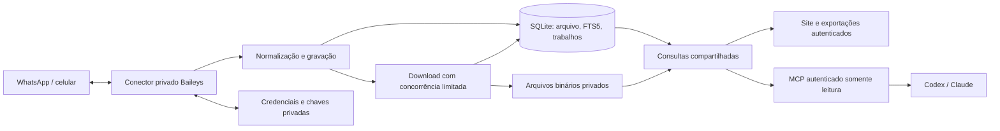
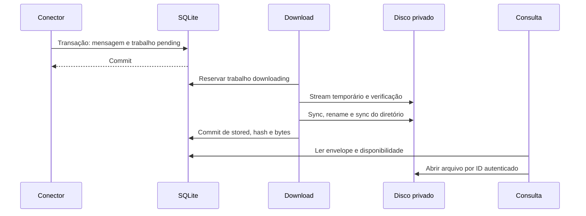

# Pesquisa de arquitetura — Zap MCP

**Domínio:** arquivo privado de uma conta pessoal de WhatsApp, site e MCP somente leitura para Codex desktop. Claude fica como compatibilidade futura, conforme esclarecimento mais recente do usuário.  
**Pesquisado em:** 2026-10-10.  
**Confiança:** MEDIUM, obtida por `classify-confidence` para Context7 e pesquisa web verificada em fontes oficiais. As propostas abaixo são decisões de engenharia; cobertura da conta, restauração da sessão e compatibilidade efetiva dos clientes continuam sem teste real.

## Arquitetura recomendada

Um processo TypeScript na VPS, com um socket Baileys, SQLite local e diretórios privados de mídia. O processo serve o site, a API de consulta e o MCP; usa uma fila persistida no próprio SQLite para downloads e exportações. As consultas leem exclusivamente o arquivo local e continuam funcionando sem WhatsApp conectado.

Baileys combina com o requisito sem navegador por implementar o protocolo de dispositivo vinculado via WebSocket. É um projeto comunitário, não uma integração oficial da Meta. Fixar a versão validada no piloto: documentação e código de `master` consultados aqui descrevem capacidades, não certificam uma versão instalável. [README oficial](https://github.com/WhiskeySockets/Baileys/blob/master/README.md)



### Limites dos componentes

| Componente | Responsabilidade | Limite obrigatório |
|---|---|---|
| Conector | Parear, persistir credenciais/chaves, receber eventos, reconectar | Único detentor do socket; nunca disponibilizá-lo a rotas ou ferramentas |
| Normalização | Converter eventos em mensagens, identidades, alterações e trabalhos | Idempotência e transações; preservar dados originais privados |
| Arquivo SQLite | Fonte canônica, referências de mídia, cobertura e FTS5 | Um escritor; consultas parametrizadas por conexão de leitura |
| Worker de mídia | Recuperar binários, verificar, finalizar e retomar downloads | Não impede a gravação de mensagens quando mídia falha |
| Consultas | Contatos, conversas, busca, contexto e metadados de anexos | Mesmas regras, envelopes e cursores para site e MCP; nenhum SQL arbitrário |
| Site/API | Login do proprietário, abas, visualização e download/exportação | Sem caminhos públicos para dados ou arquivos |
| MCP | Adaptar consultas a ferramentas e recursos | Allowlist de operações locais de leitura; sem acesso à sessão WhatsApp |
| Exportador | Materializar seleção consistente e ZIP com manifesto | Derivado do arquivo; não consulta o WhatsApp nem inclui segredos |

Estrutura suficiente: `src/whatsapp/`, `src/archive/` (schema, ingestão, consultas), `src/media/`, `src/http/`, `src/mcp/`, `src/export/` e uma entrada do processo. Em diretório persistente fora do checkout: `archive.sqlite`, armazenamento privado de sessão, `media/`, `tmp/` e `exports/`. Banco de sessão separado é razoável para impedir sua inclusão acidental em consultas/exportações; não é um segundo serviço.

## Ingestão e recuperação

### Eventos e gravação

Tratar todos os elementos dos lotes; registrar mensagens próprias recebidas do dispositivo vinculado e mensagens de terceiros. A interface de eventos oficial atual distingue história, novas mensagens, alterações e identidade. [Tipos de eventos](https://raw.githubusercontent.com/WhiskeySockets/Baileys/master/src/Types/Events.ts)

| Entrada | Tratamento no arquivo |
|---|---|
| `messaging-history.set` | Upsert de conversas, contatos e mensagens; registrar lote/progresso e mapas LID/PN |
| `messages.upsert` | Upsert de **todo** o lote, tipos `notify` e `append`; não usar chegada como data da mensagem |
| `messages.update`, `messages.delete`, reações | Aplicar alteração local idempotente; conservar revisão/evento e indicação de remoção, sem chamar operações remotas |
| Contatos, grupos e participantes | Atualizar metadados e autoria disponível; não substituir autor antigo pelo nome atual do grupo |
| `lid-mapping.update` | Vincular aliases conforme informação explícita do protocolo |
| `connection.update`, `creds.update` e armazenamento de chaves | Persistir estado da conexão, credenciais e mudanças do keystore; não logar os conteúdos |

Uma transação insere/atualiza a mensagem, seu índice e o trabalho de mídia. O corpo de origem necessário à recuperação fica em armazenamento privado, com serialização que preserve bytes e inteiros; APIs retornam apenas a projeção segura. Atualização recebida antes da mensagem deve ficar pendente pela chave, para aplicação após chegada da origem. Eventos repetidos não geram novas revisões quando o conteúdo é igual.

Guardar por conversa a mensagem mais antiga/recente recebida, data da última sincronização, origem inicial/incremental e estado de progresso. “Lote concluído” significa o que aquele lote informou, sem provar arquivo completo desde a criação da conta. Uma resposta vazia deve mencionar a cobertura conhecida.

### Identidade PN/LID e chave idempotente

IDs internos estáveis para pessoas e conversas, com tabela de aliases de JID. Preservar JID original, `remoteJidAlt`, `participantAlt`, `addressingMode` e identificador do proprietário quando disponíveis; estes campos constam nos tipos atuais. [Chaves de mensagem](https://raw.githubusercontent.com/WhiskeySockets/Baileys/master/src/Types/Message.ts)

- PN e LID são endereços do protocolo; não presumir que todo identificador seja um número telefônico ou que o LID permita calcular um PN.
- Relacionar aliases somente por mapeamento recebido e validado. Nome de contato, foto ou texto igual não prova identidade.
- Chave de mensagem: `(conversa interna resolvida, id da mensagem no protocolo, fromMe, autor resolvido)`. Em grupos, autor é o participante; mensagens próprias resolvem para o proprietário. Manter também chave original para resolver eventos posteriores.
- Se o mapa chegar tarde, unir aliases e reconciliar duplicatas em transação, preservando referências, revisões e anexos. Ausência temporária de identidade não autoriza descartar a mensagem. Testar o mesmo ID recebido primeiro por PN e depois por LID.
- Trabalho de mídia único por `(message_id interno, posição/tipo do anexo)`. Timestamp, texto ou hash da mídia não são identidade da mensagem.

### Envelope canônico para as duas interfaces

Retornar `message_id`, `conversation_id`, chave de origem sanitizada, autor/participante, `from_me`, `sent_at` em UTC, `received_at`, tipo, texto/legenda, referência de resposta citada, revisão/remoção observada e `attachments[]`. Cada anexo traz ID interno, nome original como metadado, MIME, tamanho informado/verificado, estado, motivo de indisponibilidade e SHA-256 quando salvo. Respostas incluem cobertura e cursor; nunca incluem media keys, URLs temporárias de origem, Signal keys ou dumps do protocolo. Um tipo não reconhecido aparece como registro não suportado, conservando data e autoria.

### Reinício

Persistir credenciais **e todas as mudanças do keystore**, não apenas o QR ou um `creds.json`; usar armazenamento transacional adequado à versão fixada. Após reinício: aplicar migrations, reconciliar arquivos/trabalhos interrompidos, abrir consultas locais e então restaurar a conexão. Reconexão tem atraso limitado e jitter; logout pede novo pareamento e conserva o arquivo. Apenas uma instância deve usar a sessão. A documentação destaca a persistência de chaves e recomenda armazenamento próprio para produção. [Sessão Baileys](https://github.com/WhiskeySockets/Baileys/blob/master/README.md#saving--restoring-sessions)

Persistência local não garante que um evento recebido antes de um crash, mas ainda não gravado, será reenviado. Registrar desconexões e retomar sincronização disponível; não inventar checkpoint global de mensagens nem prometer entrega exatamente uma vez pelo WhatsApp. Idempotência garante reaplicação segura dos eventos efetivamente recebidos.

## Mídia real e consistência de disco

Máquina de estados persistida:

```text
pending → downloading → stored
                    ↘ retry_wait → downloading
                    ↘ unavailable
                    ↘ blocked (espaço/limite operacional; retomável)
stored → missing_or_corrupt (detectado na verificação; tentar recuperar se possível)
```

Registrar tentativa, próxima execução, erro sanitizado e tamanho/hash. URL ou thumbnail não contam como original salvo. `unavailable` representa conclusão da tentativa de recuperação; evidência nova, como payload atualizado, pode reabrir o trabalho. Conservar separadamente motivo técnico, sem transformar 404 isolado em certeza de expiração permanente.

Usar download em stream com backpressure, poucas transferências simultâneas (começar com duas), timeout, tentativas limitadas e orçamento de espaço. Não carregar vídeos completos em RAM. Priorizar mídia nova sem deixar trabalhos antigos eternamente sem execução. Limite de segurança por arquivo suspende explicitamente o download; não marca sucesso. O helper oficial suporta stream e solicitação de recuperação da mídia em certos erros; essa solicitação é controle do protocolo, não mensagem do usuário, e precisa ser validada no piloto. [Implementação de download](https://raw.githubusercontent.com/WhiskeySockets/Baileys/master/src/Utils/messages.ts)

Protocolo de gravação proposto:

1. Confirmar registro/trabalho no SQLite antes de iniciar; gerar caminho interno por ID, sem usar nome recebido como caminho.
2. Escrever stream em temporário no **mesmo filesystem** do destino; verificar hash/tamanho conforme informações disponíveis. Nunca seguir uma URL arbitrária fornecida pelo cliente MCP.
3. Sincronizar o arquivo, fechar, renomear atomicamente e sincronizar o diretório no Linux; só então confirmar `stored` em transação SQLite. São operações disponíveis no filesystem de Node; a composição e a reconciliação são responsabilidade da aplicação. [API de filesystem](https://nodejs.org/api/fs.html)
4. Ao reiniciar, final existente sem commit pode ser verificado e adotado pelo trabalho correspondente; temporário incompleto volta à fila. Registro `stored` sem binário íntegro vira falha visível. Não apagar possíveis órfãos antes de reconciliar.



Não há transação única entre arquivo e SQLite; a ordem acima e a reconciliação resolvem as janelas de falha. Falta de espaço deve pausar mídia/exportações primeiro e preservar mensagens já salvas, com reserva operacional para banco/journal e alerta do proprietário; se a própria gravação do banco falhar, registrar indisponibilidade operacional sem confirmar ingestão.

## Consulta, abas e exportação

SQLite em WAL, transações curtas, foreign keys e escritor serializado; conexões de consulta com `query_only` e timeout de ocupação. Escolher `synchronous=FULL` para reduzir perda de commits em falha de energia, assumindo armazenamento que respeite sincronização. Não colocar SQLite/WAL em filesystem de rede. [WAL](https://www.sqlite.org/wal.html), [durabilidade](https://www.sqlite.org/pragma.html#pragma_synchronous)

FTS5 sobre texto e legenda, ligado à tabela canônica por triggers na mesma transação; criação posterior exige `rebuild`. Começar com `unicode61` e testar pt-BR, acentos e nomes. A busca pública recebe termos simples, não sintaxe SQL/FTS sem validação. [FTS5 e índice externo](https://www.sqlite.org/fts5.html#external_content_table_pitfalls)

- Histórico e busca usam ordenação cronológica determinística `(sent_at, message_id)` e paginação por chave; evitar `OFFSET` e ranking variável como cursor. Não inferir ordem exata entre mensagens com timestamp igual.
- Cursor opaco/versionado vincula filtros, conversa, limite e fronteira da página. Validar limites no servidor. Fixar teto de ingestão no início da navegação para evitar que histórico importado durante a leitura desloque as páginas; informar que alterações de mensagem podem modificar resultados.
- Abrir um resultado consulta antes/depois de `message_id`, com limites, e traz resposta citada quando arquivada. Abas são estado do site por `conversation_id`; não abrem sockets nem novos dispositivos vinculados.
- Arquivos são servidos por rota autenticada que resolve ID para caminho interno e suporta streaming/range. Renderizar texto escapado; documentos desconhecidos são download, não HTML executável. Nome original deve ser sanitizado apenas para apresentação/download.

Exportação seleciona mensagens em snapshot consistente e materializa um manifesto; gerar ZIP por stream fora da transação longa. Incluir `messages.json` e leitura humana simples, `manifest.json` com IDs, autoria, período, cobertura, estados, hashes/bytes e relação mensagem→arquivo, além dos binários `stored`. Anexos ausentes aparecem no manifesto com motivo. Nunca incluir banco bruto, credenciais, chaves, URLs de origem ou logs.

Seleção congelada preserva as versões de mensagem e referências de mídia usadas na exportação; alterações posteriores não mudam silenciosamente seu conteúdo. ZIP temporário só passa a pronto após finalização verificada. Jobs pesados ficam persistidos e consultáveis; limitar geração simultânea a uma. Download exige sessão do proprietário ou credencial autorizada e tem validade operacional; sem URL pública permanente. Não reutilizar token MCP em URL. Limpar apenas exportações derivadas e temporários reconhecidos, não o acervo.

## MCP e política somente leitura

Ferramentas pequenas: `find_conversations`, `search_messages`, `read_conversation`, `get_message_context` e `get_attachment`. Expor retornos estruturados limitados, IDs estáveis, cursor, cobertura e motivos de ausência. `readOnlyHint` ajuda o cliente, mas a proteção é a implementação: nenhum método de envio, edição, exclusão, alteração de conversa, SQL genérico ou filesystem arbitrário. A consulta MCP jamais chama o conector.

O WhatsApp exige tráfego de autenticação, sincronização, acknowledgements e eventualmente recuperação de mídia. “Somente leitura” é política de ações do usuário: **sem** `sendMessage`, `chatModify`, `readMessages`, receipts `read`/`read-self`/`played` ou presença de digitação acionados ao consultar. Receber uma edição/remoção e registrá-la localmente não é editá-la remotamente. Testar abertura de conversa e reprodução local de áudio com spies de operações e observação no telefone. Evitar publicar o estado online por opção do conector quando suportado; não prometer conexão de protocolo totalmente invisível.

### Transporte e autenticação por cliente

Preferir Streamable HTTP em `/mcp` com HTTPS e autenticação em **cada** requisição; sessão de transporte não é autorização. Endpoints de metadados OAuth podem ser públicos sem dados privados. Validar origem quando presente e host esperado; não usar cookie de login do site como único mecanismo MCP. [Transporte oficial](https://modelcontextprotocol.io/specification/2026-07-28/basic/transports/streamable-http)

**Decisão do v1:** o cliente obrigatório é Codex desktop. Usar token bearer aleatório, revogável, exclusivo do MCP e limitado à leitura; guardar segredo na configuração privada do host por mecanismo suportado, não em código ou URL. Login do site tem sessão própria e autentica somente o proprietário. Não construir OAuth, cadastro de clientes nem bridge local nesta versão: eles não são necessários para a superfície confirmada. Validar rejeição de token ausente, inválido e revogado, além do acesso funcional no Codex do usuário.

| Cliente | Caminho válido para planejar | Condição de aceite |
|---|---|---|
| Codex desktop — obrigatório no v1 | HTTP com bearer por mecanismo privado suportado no host | Inicializar, listar ferramentas, buscar contexto e recuperar um arquivo com a configuração real |
| Claude Code — futuro | HTTP com cabeçalho ou OAuth conforme cliente | Testar somente quando este cliente entrar no escopo |
| Claude Desktop local — futuro | Mecanismo local/stdio distinto do conector remoto | Bridge pode ser alternativa futura se houver impedimento medido, sem construir agora |
| Claude.ai/conector remoto — futuro | OAuth interoperável como base quando cabeçalho fixo não estiver disponível | Conexão parte da nuvem Anthropic; um endpoint alcançável pelo computador do usuário não prova acesso pela nuvem |

[Codex oficial](https://learn.chatgpt.com/docs/extend/mcp?surface=cli), [Claude Code oficial](https://code.claude.com/docs/en/mcp), [origem dos conectores Claude](https://support.claude.com/en/articles/11175166-get-started-with-custom-connectors-using-remote-mcp)

**Limite atual de bearer-only em Claude web:** o guia detalhado oficial informa autenticação por Request headers em beta para organizações selecionadas. O resumo do Help Center menciona cabeçalhos sem essa ressalva. Só usar essa simplificação depois de verificar disponibilidade na conta e autenticação efetiva; não anunciá-la como garantia. Um bridge localhost não atende claude.ai. [Guia detalhado e restrição de rollout](https://claude.com/docs/connectors/custom/add-unlisted#authenticate-with-request-headers)

Se **futuramente** o alvo incluir Claude web sem Request headers, implementar servidor de recurso OAuth com biblioteca/provedor maduro: protected-resource metadata, discovery do authorization server, PKCE, parâmetro `resource`, audience, validade e escopo `archive:read`, além de método de registro compatível com os clientes (pré-registro, CIMD ou DCR conforme suporte). Credenciais nunca passam na query string. Só a identidade do proprietário recebe acesso; cadastro de cliente OAuth não equivale a autorização para ler. Não improvisar um login web ou JWT isolado e chamá-lo de OAuth MCP. Esta alternativa não cria trabalho ou infraestrutura no v1. [Autorização MCP vigente](https://modelcontextprotocol.io/specification/2026-07-28/basic/authorization)

`get_attachment` informa estado e referência privada; recuperar **bytes reais** precisa de prova no Codex desktop. Para arquivos pequenos, usar recurso/conteúdo MCP suportado pelo host; para grandes, download autenticado por API com fluxo privado comprovado no cliente. Não presumir que todo host aceita `resources/read`, segue link com o bearer ou comporta base64 de vídeo em contexto. Definir limite explícito e entrega privada durante a fase MCP; metadados isolados não cumprem recuperação de arquivo. Bridge é alternativa futura mediante impedimento real, não componente obrigatório. Transcrição/OCR permanecem fora do serviço.

## Operação e backup recuperável

Um serviço supervisionado, volumes locais persistentes, dono exclusivo dos diretórios privados e apenas um processo usando a sessão. QR deve aparecer somente na superfície de administração protegida ou terminal privado; nunca nos logs. Proteger site, API, mídia, exportação e MCP **desde a primeira exposição externa**. Não esperar a fase final para acrescentar login/TLS.

Para uma conta, a opção inicial mais simples é backup com breve parada controlada: drenar gravações/downloads, fechar conexão e bancos, copiar estado consistente de banco, mídia e sessão, registrar manifesto/hashes e retomar. Guardar cópia cifrada fora da VPS, com chave de recuperação disponível ao proprietário. Alternativa futura é backup SQLite online mais snapshot coordenado de mídia/sessão; copiar apenas o `.sqlite` enquanto WAL está ativo é insuficiente. [Backup API oficial](https://www.sqlite.org/backup.html)

Verificar restauração em diretório isolado: integridade SQLite/FTS, contagens, referências e hash de mídia, consulta web/MCP com WhatsApp desligado e leitura dos dados necessários à sessão. Só depois, com instância original desligada, testar conexão restaurada. Backup da sessão pode ter sido revogado ou estar incompatível com o estado remoto: isso não invalida o arquivo restaurado, mas pode exigir novo QR. Não iniciar duas sessões a partir do mesmo snapshot.

Os primeiros limites serão disco de mídia/ZIP, downloads grandes e consultas/exportações longas. Medir tamanho, fila e falhas antes de acrescentar infraestrutura. Redis, broker, microserviços, armazenamento vetorial e banco remoto não entregam valor necessário para uma conta neste v1.

## Ordem sugerida de capacidades utilizáveis

1. **Prova com a conta real:** pareamento privado, ingestão em SQLite, leitura de mensagens armazenadas, reconexão sem duplicação e cobertura observada. Antes disso, interface elaborada não valida a integração.
2. **Retenção de arquivos:** baixar áudio/imagem/vídeo/documento disponíveis, reabrir bytes sem WhatsApp, demonstrar estado ausente e recuperação após crash.
3. **Site de arquivo:** autenticação, busca/contexto, abas, download e ZIP com manifesto; toda exposição protegida.
4. **Consulta por IA:** mesmo acervo por MCP HTTP, bearer revogável e entrega privada comprovada de arquivos no Codex desktop. Compatibilidade Claude/OAuth não é requisito de aceite nem trabalho inicial.
5. **Prontidão da VPS:** ambiente/domínio, supervisão, capacidade medida, backup e ensaio de restauração; segurança já acompanha os incrementos anteriores.

Pesquisa adicional necessária nas fases 1 e 4: versão efetiva de Baileys e cobertura da conta; PN/LID e sessão da versão escolhida; leitura de mídia e configuração autenticada no Codex desktop do usuário. Claude exigirá pesquisa apenas se promovido ao escopo. SQLite/FTS5 e site seguem padrões conhecidos, com testes de paginação, índice após alterações e acesso negado. Nenhuma vinculação, instalação, código de aplicação ou implantação foi realizada nesta pesquisa.

## Fontes e confiança

Todas as fontes acima são primárias dos mantenedores ou produtos e foram abertas em 2026-10-10. Context7 orientou a pesquisa de Baileys, SQLite e MCP; documentos/código oficiais confirmaram os pontos citados. O resolvedor MCP `latest` apontou para a especificação **2026-07-28**. As páginas de clientes são atualizadas continuamente; suporte disponível na conta precisa de verificação funcional. Confiança documental MEDIUM conforme seam; recomendações arquiteturais são inferências identificadas, sem validação de produção.
