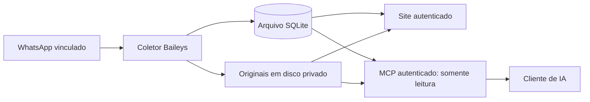

# Zap MCP

**Seu acervo de WhatsApp, pesquisável no navegador e consultável por assistentes via MCP.**

Um arquivo privado de WhatsApp para pesquisar conversas, recuperar anexos e consultar mensagens pelo Codex. O coletor se conecta como dispositivo vinculado por QR, sem executar um navegador.

O código pode ser público; seu acervo continua privado. A aplicação atende **uma conta, um proprietário e um coletor**.

[Recursos](#o-que-você-pode-fazer) · [Arquitetura](#arquitetura) · [Instalação](#instalação-local) · [Uso](#como-consultar) · [MCP](#conectar-ao-codex-por-mcp) · [Operação e privacidade](#operação-privacidade-e-contribuição)

## O que você pode fazer

- Pesquisar conversas por contato, texto e período.
- Abrir resultados no contexto da conversa e manter conversas em abas.
- Visualizar ou baixar os originais disponíveis de imagens, áudios, vídeos e documentos.
- Exportar uma conversa ou período em ZIP, com mensagens, manifesto e anexos disponíveis.
- Consultar o acervo por um servidor MCP autenticado e somente leitura.
- Continuar lendo o arquivo mesmo com o WhatsApp desconectado.

O site e o MCP não oferecem envio, edição, exclusão ou confirmação de leitura no WhatsApp. A conexão usa [Baileys](https://github.com/WhiskeySockets/Baileys), uma integração não oficial em versão prerelease; compatibilidade e disponibilidade podem mudar. Só é arquivado o conteúdo recebido: **não há garantia de histórico completo nem de recuperação de todas as mídias**.

## Arquitetura



A coleta e a consulta têm papéis diferentes: o coletor recebe o conteúdo; o site e o MCP leem o acervo local. Isso permite consultar o material já arquivado mesmo sem uma conexão ativa com o WhatsApp.

| Camada | Implementação |
| --- | --- |
| Runtime | Node.js 24, TypeScript e módulos ESM. |
| Serviço web | Express, autenticação do proprietário e interface HTML/CSS/JavaScript. |
| Arquivo | SQLite com `better-sqlite3`; arquivos de mídia fora do checkout. |
| Integração WhatsApp | Baileys, vinculado por QR, sem navegador automatizado. |
| Acesso para IA | Model Context Protocol com token próprio e ferramentas de consulta. |
| Operação | Comandos de backup, verificação de restauração e preflight; exemplo de deploy em Docker. |

### Mapa do código

| Arquivo ou diretório | Responsabilidade |
| --- | --- |
| [`src/main.ts`](src/main.ts) | Serviço HTTP, rotas e composição da aplicação. |
| [`src/archive.ts`](src/archive.ts) | Persistência e consultas ao acervo. |
| [`src/whatsapp.ts`](src/whatsapp.ts) | Coletor e estado da conexão. |
| [`src/media.ts`](src/media.ts) | Originais, verificação e entrega de anexos. |
| [`src/mcp.ts`](src/mcp.ts) | Adaptador MCP e autenticação por token. |
| [`src/backup.ts`](src/backup.ts) | Cópias, restauração, verificação e preflight. |
| [`public/`](public/) | Interface web. |
| [`test/`](test/) | Testes automatizados. |
| [`ops/`](ops/) | Documentação e ferramentas operacionais. |

As versões fixadas e os scripts estão em [package.json](package.json) e `package-lock.json`. O comando `npm test` compila o projeto e executa os testes presentes no repositório; consulte também [CONTRIBUTING.md](CONTRIBUTING.md).

## Instalação local

Os comandos abaixo usam Bash em Linux. Use **Node.js 24.21.0**, com npm, para reproduzir o ambiente do projeto. A instalação de SQLite pode exigir Python 3, `make` e compilador C++ quando não houver um binário nativo compatível. O coletor não precisa de Chrome ou Playwright.

### 1. Baixe e compile

```bash
git clone https://github.com/dlr-1337/zap-mcp.git
cd zap-mcp
node --version # esperado: v24.21.0
node ops/verify-dependencies.mjs
npm ci
npm run build
```

O verificador compara os pins e o lock com o registro npm oficial antes da instalação; precisa de acesso à internet. As versões estão fixadas em `package-lock.json`. Não copie `node_modules` de outra máquina.

### 2. Crie o perfil e a senha

Escolha uma pasta privada **fora do repositório**, que não seja pública nem sincronizada automaticamente. Neste exemplo ela fica no seu diretório pessoal:

```bash
umask 077
export ZAP_PRIVATE_ROOT="$HOME/.local/share/zap-mcp"
export ZAP_DATA_DIR="$ZAP_PRIVATE_ROOT/profile"
export ZAP_PORT=3000
install -d -m 700 "$ZAP_PRIVATE_ROOT" "$ZAP_PRIVATE_ROOT/snapshots" "$ZAP_PRIVATE_ROOT/restores"
node dist/src/main.js profile-init
read -r -s -p 'Senha do site: ' ZAP_OWNER_PASSWORD
printf '\n'
printf '%s' "$ZAP_OWNER_PASSWORD" | node dist/src/main.js owner-set
unset ZAP_OWNER_PASSWORD
```

`profile-init` cria um perfil novo; não conecta o WhatsApp nem substitui um perfil corrompido. `owner-set` recebe a senha por entrada padrão, exige o serviço parado e revoga os logins anteriores. Não coloque a senha em argumentos, arquivos versionados ou exemplos públicos.

As variáveis precisam continuar definidas nos próximos passos. Em outro terminal, exporte os mesmos valores. A aplicação **não carrega `.env` automaticamente**; [.env.example](.env.example) documenta as opções.

### 3. Confira o site sem conectar a conta

```bash
npm start
```

Abra [http://127.0.0.1:3000](http://127.0.0.1:3000) e entre com a senha criada. O acervo novo estará vazio. `serve`, usado por `npm start`, mantém o coletor desligado e aceita acesso local por loopback.

Pare com **Ctrl+C** e aguarde o encerramento antes do próximo passo. Esse modo também serve para consultar um acervo já existente sem conectar o WhatsApp.

### 4. Prepare e confira a primeira cópia

O coletor só inicia depois de uma cópia restaurada e conferida do mesmo perfil:

```bash
node dist/src/main.js backup "$ZAP_PRIVATE_ROOT/snapshots/initial-001"
node dist/src/main.js verify-backup "$ZAP_PRIVATE_ROOT/snapshots/initial-001" "$ZAP_PRIVATE_ROOT/restores/verification-001"
node dist/src/main.js preflight
```

Os dois destinos devem ser novos. `verify-backup` testa a restauração isolada e grava um recibo no perfil fonte. Ele altera apenas a senha da cópia de verificação para exercitar o login; o perfil original mantém sua senha. Não remova o snapshot usado pelo recibo. Para repetir a operação, escolha novos nomes.

### 5. Vincule o WhatsApp

```bash
node dist/src/main.js serve --collect
```

Entre novamente no site. Quando o QR aparecer, abra **Dispositivos conectados** no WhatsApp do celular e escaneie-o. Aguarde a conexão e a chegada dos dados. O QR é privado e só aparece na sessão autenticada.

Use sempre o mesmo `ZAP_DATA_DIR`. Um acervo restaurado permanece offline até uma promoção com exclusividade comprovada; não execute dois coletores com cópias da mesma sessão. Se o preflight falhar, corrija o motivo e confira a cópia novamente; não remova travas nem tente contornar o bloqueio.

## Como consultar

Depois do login, localize o contato ou grupo e combine texto e datas. Escolha entre os candidatos apresentados; nomes iguais não identificam a mesma conversa. Os dias dos filtros usam **America/Sao_Paulo**, mantendo o instante original recebido. Mensagens sem data conhecida são identificadas como tal.

Abra um resultado para ler as mensagens próximas. Cada aba preserva sua posição. Imagens, áudios e vídeos compatíveis abrem sob ação; outros formatos disponíveis podem ser baixados como originais.

A exportação inclui **todo o recorte arquivado selecionado**, além da página visível. O ZIP contém `mensagens.txt`, `manifest.json` e os originais disponíveis. Anexos faltantes e alterações observadas são indicados no manifesto. Conteúdo indisponível não é inventado, e uma exportação com falha não aparece como pronta.

## Conectar ao Codex por MCP

Para acesso remoto, configure primeiro um endereço HTTPS privado conforme o [guia operacional](ops/README.md#https-e-proxy). O endpoint é `/mcp`; o token MCP é independente da senha do site.

No servidor, com `ZAP_DATA_DIR` apontando ao perfil correto, gere um token em um **arquivo novo** e privado:

```bash
install -d -m 700 "$ZAP_PRIVATE_ROOT/mcp"
node dist/src/main.js mcp-token-rotate "$ZAP_PRIVATE_ROOT/mcp/token-001"
```

Transfira esse arquivo ao computador cliente por um canal privado, preservando permissão `0600`. No cliente, substitua o caminho e o domínio fictícios abaixo:

```bash
read -r ZAP_MCP_TOKEN < /caminho/privado/mcp/token-001
export ZAP_MCP_TOKEN
codex mcp add zap_archive --url https://archive.example.test/mcp --bearer-token-env-var ZAP_MCP_TOKEN
codex
unset ZAP_MCP_TOKEN
```

O processo Codex deve receber a variável: neste exemplo, abra o CLI a partir desse terminal. Não grave o bearer no TOML, prompt, URL ou argumentos. Use um nome de servidor ainda livre e preserve os demais registros. Uma CA privada deve ser confiada especificamente pelo cliente; não desative a verificação TLS. Consulte também a [documentação do MCP no Codex](https://developers.openai.com/codex/mcp).

| Ferramenta | Para que serve |
|---|---|
| `find_conversations` | Localizar candidatos e seus IDs canônicos. |
| `search_messages` | Buscar texto, conversa e período, com paginação. |
| `get_context` | Recuperar uma mensagem de referência e continuar antes ou depois dela. |
| `get_attachment` | Obter um original disponível ou o motivo de sua indisponibilidade. |

Siga os cursores com os mesmos filtros. Os recortes expiram em até 30 minutos; os limites são explícitos, sem truncamento silencioso de evidências. Imagens reconhecidas de até 256 KiB podem vir inline. Outros originais exigem download separado, com bearer vigente, da mesma origem HTTPS; confira tamanho e SHA-256. Um link ou metadado não significa que o arquivo foi salvo.

Rotacionar o token usando outro arquivo novo revoga o token anterior, seus cursores e transferências futuras. Recarregue a variável e reinicie o cliente. Logout do site não revoga o MCP. Para retirar o registro do Codex, use `codex mcp remove zap_archive`.

Mensagens e arquivos são conteúdo não confiável, nunca instruções privilegiadas. Peça referências e contexto ao consultar o acervo; “não encontrado” significa apenas ausência no material observado.

## Operação, privacidade e contribuição

- [Guia operacional](ops/README.md): Docker, HTTPS, backup externo, restauração e atualização.
- [Guia de contribuição](CONTRIBUTING.md): estrutura do código, testes e verificações.
- [Licença MIT](LICENSE).

SQLite guarda mensagens e estado da sessão; os binários de mídia ficam em disco privado. O coletor é o único componente conectado ao WhatsApp, e site/MCP consultam o arquivo local.

Mantenha mensagens reais, originais, bancos, sessão, QR, tokens, senhas, configurações operacionais e snapshots fora do Git. O `.gitignore` é uma proteção adicional; não torna seguro guardar dados privados dentro do checkout. Restrições de privacidade recebidas depois bloqueiam acesso futuro ao conteúdo; bytes já entregues não podem ser recolhidos.

Para relatar um problema, envie passos de reprodução, versões e erros sanitizados. Nunca anexe seu banco, sessão, QR ou conversas reais a uma issue pública.
